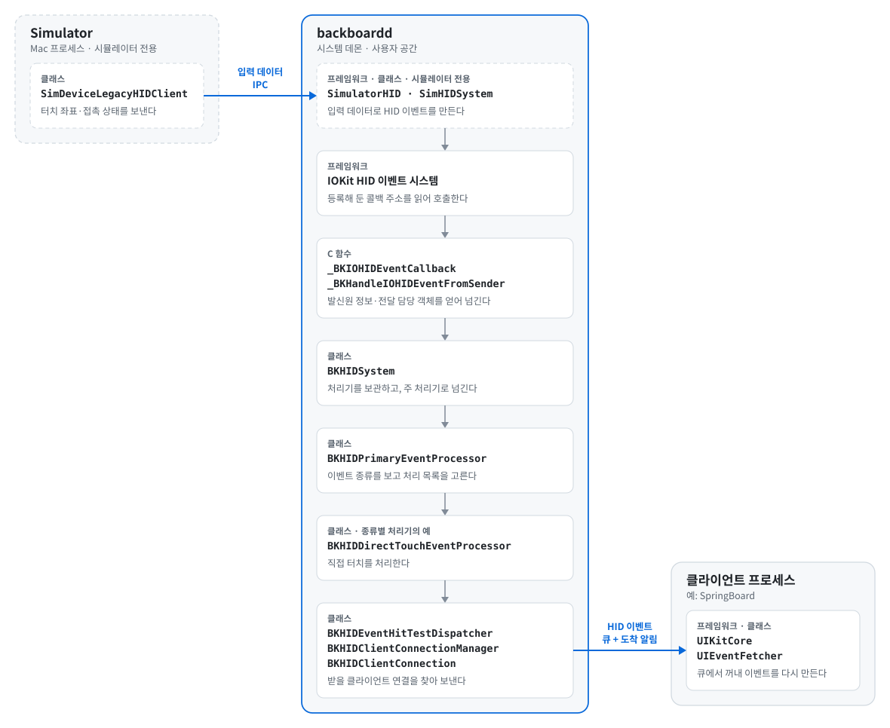

# backboardd

## 개요

화면 터치·버튼 누름처럼 사람이 기기를 조작한 입력의 처리·전달에 관여하는 iOS 시스템 데몬 프로세스. HID 입력 이벤트를 받아 종류별 처리기로 처리한 뒤, 그 입력 정보를 클라이언트 프로세스(예: SpringBoard)로 보낸다.

| 항목        | 내용                                     |
| ----------- | ---------------------------------------- |
| 종류        | 프로세스 (시스템 데몬)                   |
| 실행 영역   | 사용자 공간                              |
| 띄우는 주체 | launchd (시뮬레이터에서는 `launchd_sim`) |

## 용어

### HID 입력 이벤트

입력 장치가 감지한 조작 하나를 시스템이 다룰 수 있는 데이터로 만든 것. HID(Human Interface Device)는 터치스크린·버튼·키보드처럼 사람이 직접 다루는 입력 장치를 말한다.

- 이벤트마다 **종류**가 있다. 화면 터치는 Digitizer 종류다.
- 종류에 따라 담는 값이 다르다. 터치라면 좌표, 접촉 여부 같은 값이다.
- 여기서는 이 중 화면 터치(Digitizer)를 따라가 본다.

### 종류별 처리기

backboardd 안에서 HID 입력 이벤트를 종류별로 맡아 처리하는 객체들.

- 어떤 처리기를 만들지, 어떤 종류에 어떤 처리기를 붙일지는 처리기 구성표 `EventProcessorConfiguration.plist`가 정한다 → [상태](#상태)
- 이벤트가 오면 `BKHIDPrimaryEventProcessor`가 종류를 보고 그 종류의 처리기에게 넘긴다.
- 예: Digitizer 이벤트의 처리 목록에는 직접 터치를 처리하는 `BKHIDDirectTouchEventProcessor`가 있다.

## 책임

- **HID 입력 이벤트 처리·전달**: 들어온 입력 이벤트를 종류에 맞는 처리기로 처리하고, 이 입력을 받아야 할 프로세스를 찾아 보낸다.
- **그 밖의 역할**: 입력 말고도 하는 일이 더 있다. 여기서는 입력만 다룬다.

## 구조

<p align="center">
  
</p>

| 구성요소                        | 종류                | 하는 일                                                                                                   |
| ------------------------------- | ------------------- | --------------------------------------------------------------------------------------------------------- |
| `SimulatorHID` · `SimHIDSystem` | 프레임워크 · 클래스 | 시뮬레이터 전용. Simulator가 보낸 입력 데이터로 HID 이벤트를 만든다                                       |
| IOKit HID 이벤트 시스템 코드    | 프레임워크          | 이벤트가 도착하면 등록된 콜백 주소를 읽어 호출한다. backboardd 안에서 실행된다                            |
| `_BKIOHIDEventCallback`         | C 함수              | IOKit이 호출하는 콜백. 처리 함수로 넘긴다                                                                 |
| `_BKHandleIOHIDEventFromSender` | C 함수              | `sender`(이벤트를 보낸 장치)와 `dispatcher`(이벤트를 보낼 곳을 정하는 객체)를 얻어 `BKHIDSystem`에 넘긴다 |
| `BKHIDSystemInterface`          | 클래스              | 이벤트 처리를 시작하는 진입점(`startEventProcessing`)                                                     |
| `BKHIDSystem`                   | 클래스              | 처리기와 관련 객체를 보관하고, 콜백을 등록하고, 이벤트를 주 처리기로 넘긴다                               |
| `BKHIDPrimaryEventProcessor`    | 클래스              | 이벤트 종류를 조회해 그 종류의 처리 목록을 고른다                                                         |
| 종류별 처리기                   | 클래스들            | 예: `BKHIDDirectTouchEventProcessor`(직접 터치 처리)                                                      |
| `BKHIDEventHitTestDispatcher`   | 클래스              | 이벤트를 보낼 클라이언트를 정해 전송을 시작한다                                                           |
| `BKHIDClientConnectionManager`  | 클래스              | 클라이언트 연결 목록을 들고, 보낼 연결을 찾는다                                                           |
| `BKHIDClientConnection`         | 클래스              | 연결 하나. 실제 전송 함수를 부른다                                                                        |

## 상태

| 무엇                                              | 종류                 | 어디에                              | 언제 생기나         |
| ------------------------------------------------- | -------------------- | ----------------------------------- | ------------------- |
| 이벤트 처리기들                                   | Objective-C 객체     | `BKHIDSystem`이 보관                | 수명주기 · 준비 1~3 |
| 처리기 구성표 `EventProcessorConfiguration.plist` | plist 파일           | 디스크                              | 미리 있음           |
| `_BKIOHIDEventCallback`의 주소                    | 함수 포인터 (값)     | IOKit HID 이벤트 시스템의 내부 상태 | 수명주기 · 준비 4~5 |
| 클라이언트 연결 목록                              | 목록 (자료형 미확인) | `BKHIDClientConnectionManager`      | 미확인              |

처리기 구성표는 두 키를 쓴다.

| 키                | 내용                             |
| ----------------- | -------------------------------- |
| `CreationOrder`   | 어떤 처리기를 어떤 순서로 만들지 |
| `ProcessorChains` | 이벤트 종류별 처리기 목록        |

두 키 모두 `BKHIDDirectTouchEventProcessor`를 포함한다.

## 수명주기

시작 → 준비 → 대기 → 이벤트 처리 순으로 진행된다. Apple이 공개하지 않은 내부 구현이라, 바이너리에서 찾은 함수·메서드 이름과 호출 순서를 중심으로 정리했다.

### 1. 시작

backboardd가 이벤트 처리를 시작할 때 `BKHIDSystemInterface`의 `startEventProcessing`이 실행된다. 정확히 언제 불리는지는 아직 모른다.

### 2. 준비

1. `startEventProcessing` 안에서 C 함수 `BKHIDCreatePrimaryEventProcessor(...)`를 호출한다.
2. 그 함수가 `EventProcessorConfiguration.plist`를 읽는다. `CreationOrder`에 적힌 클래스 이름으로 클래스를 찾아 `alloc` → `initWithContext:`로 처리기 객체를 만들고, `ProcessorChains`에 따라 이벤트 종류별 처리 목록을 구성한다.
3. `BKHIDSystem`의 `startEventProcessor:mainDisplayObserver:deliveryManager:dispatcherProvider:`가 만들어진 처리기와 관련 객체들을 받아 보관한다. 나중에 이벤트가 오면 이 객체가 보관해 둔 처리기에게 넘기기 때문이다.
4. 같은 객체가 자기 메서드 `_beginHandlingEvents`를 호출하고, 그 안에서 IOKit의 C 함수를 부른다.

   ```c
   IOHIDEventSystemSetCallback(hidEventSystem, _BKIOHIDEventCallback, self, NULL);
   ```

   | 인자                    | 뜻                                                                             |
   | ----------------------- | ------------------------------------------------------------------------------ |
   | `hidEventSystem`        | 콜백을 등록할 HID 이벤트 시스템                                                |
   | `_BKIOHIDEventCallback` | **함수의 주소**. 지금 실행하는 게 아니라 "나중에 이 함수를 불러 달라"고 넘긴다 |
   | `self`                  | 나중에 콜백이 불릴 때 첫 인자(`target`)로 돌려받을 객체. `BKHIDSystem` 자신    |
   | `NULL`                  | 등록자가 돌려받을 추가 문맥(`refcon`). 이번엔 없음                             |

5. `IOHIDEventSystemSetCallback`은 함수 주소와 받은 값들을 HID 이벤트 시스템의 내부 상태에 저장하고 반환한다. `_beginHandlingEvents`도 반환한다.

### 3. 대기

**어느 함수도 대기 상태로 남아 있지 않다.** 남은 것은 IOKit 내부 상태에 저장된 콜백 주소와, `BKHIDSystem`이 보관한 처리기들이다.

### 4. 이벤트 처리

1. 이벤트가 도착하면 IOKit의 이벤트 처리 코드(`__IOHIDEventSystemEventCallback`)가 실행되어, 준비 5에서 저장한 주소를 읽고 그 함수를 호출한다.
2. `_BKIOHIDEventCallback(target, refcon, sender, event)`가 **여기서 비로소 실행된다.**

   | 인자     | 뜻                                                       |
   | -------- | -------------------------------------------------------- |
   | `target` | 등록할 때 넘긴 `BKHIDSystem` 객체. 이 함수는 쓰지 않는다 |
   | `refcon` | 등록할 때 넘긴 `NULL`. 쓰지 않는다                       |
   | `sender` | 이번 입력을 보낸 장치(HID 서비스)를 가리키는 값          |
   | `event`  | 처리할 HID 이벤트                                        |

3. 그 안에서 `_BKHandleIOHIDEventFromSender(event, sender)`를 호출한다. 이 함수는 받은 `sender` 값으로 **`sender` 객체**를, `dispatcherForEvent:`로 **`dispatcher` 객체**를 얻은 뒤 다음을 호출한다.

   ```objc
   [hidSystem processEvent:event sender:senderObject dispatcher:dispatcherObject];
   ```

4. `BKHIDSystem`은 보관해 둔 `BKHIDPrimaryEventProcessor`의 같은 이름 메서드로 넘긴다.
5. `BKHIDPrimaryEventProcessor`는 `IOHIDEventGetType(...)`으로 이벤트 종류를 조회하고, 그 종류의 처리 목록을 골라 처리기에게 넘긴다.
6. 처리가 끝난 이벤트는 `dispatcher` 객체를 거쳐 클라이언트로 보내진다. → [인터페이스 · 출력](#출력)

## 인터페이스

| 방향 | 상대                                          | 수단                                    | 오가는 것       |
| ---- | --------------------------------------------- | --------------------------------------- | --------------- |
| 입력 | 플랫폼마다 다름 ([플랫폼 차이](#플랫폼-차이)) | IOKit HID 이벤트 시스템의 콜백          | HID 이벤트      |
| 출력 | 클라이언트 프로세스                           | HID 이벤트 시스템 연결 · 큐 + 도착 알림 | HID 이벤트 내용 |

### 출력

보낼 연결을 찾아 전송하는 경로는 다음과 같다.

```
BKHIDEventHitTestDispatcher  sendEvent:toClientTaskPort:
→ BKSendHIDEventToClientWithTaskPort(...)                    C 함수
→ BKHIDClientConnectionManager  sendEvent:toClientTaskPort:  보낼 연결 조회
→ BKHIDClientConnection  sendEvent:
→ IOHIDEventSystemConnectionDispatchEvent(...)
```

전송 방식:

- 보내는 쪽은 HID 이벤트를 **큐**에 넣고, 필요하면 도착을 **알림**으로 알린다.
- 받는 쪽은 큐에서 꺼내 HID 이벤트를 **다시 구성**하고, 미리 등록해 둔 콜백을 실행한다.
- RunningBoard 쪽의 XPC 메시지와는 다른 방식이다.

## 플랫폼 차이

|                        | 시뮬레이터                                                                       | 실기기 |
| ---------------------- | -------------------------------------------------------------------------------- | ------ |
| 입력의 출발점          | Mac의 `Simulator` 프로세스가 터치 좌표·접촉 상태 같은 입력 데이터를 IPC로 보낸다 | 미확인 |
| HID 이벤트를 만드는 곳 | **backboardd 안**의 `SimHIDSystem`                                               | 미확인 |

즉 시뮬레이터에서는 완성된 이벤트가 밖에서 들어오는 게 아니라, 입력 데이터만 들어오고 이벤트는 backboardd 안에서 만들어진다.

## 미해결 질문

- 실기기에서 터치 하드웨어부터 backboardd까지
  - 드라이버가 내보내는 데이터의 형태
  - 그것을 전달하는 주체 (커널 드라이버인지 사용자 공간 코드인지)
  - backboardd가 처음 받는 함수
- `startEventProcessing`이 언제 불리는지.
- 클라이언트 연결 목록이 언제 생기는지.
- `_BKHandleIOHIDEventFromSender`가 반환하는 `0`의 의미.
- 입력 외에 backboardd가 맡는 일의 목록.

## 관련 문서

- 노드
  - [SpringBoard](springboard.md): backboardd가 보낸 입력 정보를 받는 클라이언트 중 하나.
- 경로
  - [앱 실행: 터치 → AppDelegate.init()](../paths/app-launch.md)

## 참고 문헌

### 정적 분석

iOS 26.1 시뮬레이터(23B86)의 backboardd 바이너리와 IOKit HID 이벤트 시스템 구현을 정적으로 분석했다.

- 구조: 구성요소와 이벤트가 넘어가는 순서
- 상태: 처리기 객체, 처리기 구성표와 두 키, 콜백 주소, 클라이언트 연결 목록의 위치
- 수명주기: 준비 1~5, 이벤트 처리 1~6
- 인터페이스: 출력 경로, 큐 + 알림 전송 방식
- 플랫폼 차이: 시뮬레이터의 입력 데이터 IPC와 `SimHIDSystem`의 이벤트 생성
