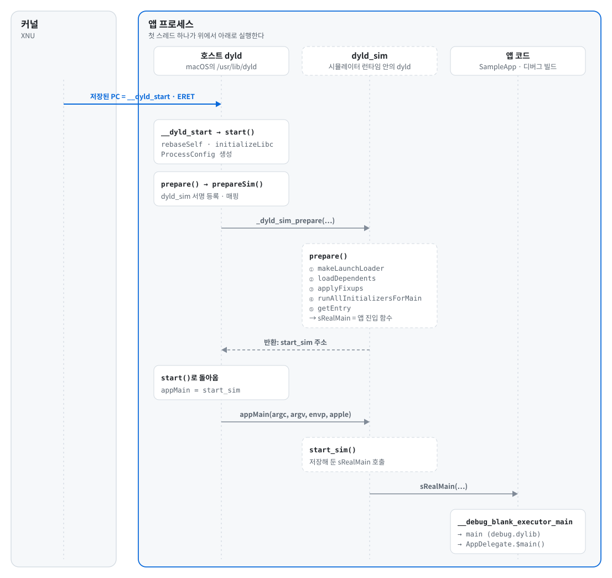

# dyld (dynamic link editor)

## 개요

앱 프로세스 안에서 앱 코드보다 먼저 실행되는 동적 링커. 앱이 쓰는 라이브러리를 찾아 연결하고, 초기화 코드를 실행한 뒤, 앱의 진입 함수(`main`)를 호출한다.

| 항목               | 내용                                                                                                                                  |
| ------------------ | ------------------------------------------------------------------------------------------------------------------------------------- |
| 종류               | 실행 파일 ([Mach-O](mach-o.md)의 `MH_DYLINKER` 종류). 따로 프로세스로 실행되지 않고, 앱 프로세스에 함께 올라가 앱의 스레드가 실행한다 |
| 실행되는 곳        | 앱 프로세스 안, 앱의 첫 스레드                                                                                                        |
| 경로               | `/usr/lib/dyld` (시뮬레이터에서는 런타임 안의 `usr/lib/dyld_sim`도 거친다)                                                            |
| 실행을 넘기는 주체 | 커널 (저장된 PC를 dyld의 시작 위치로 맞춘다)                                                                                          |

## 용어

### 동적 링커

프로그램이 실행될 때 그 프로그램이 쓰는 라이브러리를 찾아 주소 공간에 올리고, 실제 주소로 이어 주는 프로그램. 빌드할 때는 "이 라이브러리의 이 함수가 필요하다"만 적어 두고, 연결은 실행할 때 한다. Apple 플랫폼에서는 dyld가 이 일을 한다.

### 이미지

주소 공간에 올라가는 실행 파일 하나, 또는 라이브러리 하나.

### `Loader`

dyld가 이미지마다 하나씩 만드는 관리 객체. 앱 실행 파일의 Loader가 출발점이 되고, 거기서 의존 관계를 따라 라이브러리들의 Loader가 생긴다.

### fixup (리베이스 · 바인딩)

이미지 안의 포인터 값을 실제 실행 상황에 맞게 고쳐 쓰는 일.

|          | 하는 일                                                                           | 왜 필요한가                                                                                  |
| -------- | --------------------------------------------------------------------------------- | -------------------------------------------------------------------------------------------- |
| 리베이스 | 이미지 안을 가리키는 포인터에 slide만큼 더한다                                    | 이미지가 파일에 적힌 기준 주소와 다른 곳에 올라가기 때문이다 (slide = 실제 주소 − 기준 주소) |
| 바인딩   | 다른 이미지의 심볼(예: `UIApplicationMain`)을 가리킬 자리에 그 실제 주소를 채운다 | 빌드할 때는 그 라이브러리가 어디에 올라갈지 모르기 때문이다                                  |

### 공유 캐시 (dyld shared cache)

시스템 라이브러리들을 미리 하나로 묶고 서로 연결까지 해 둔 파일. 여러 프로세스가 같은 캐시를 매핑해 쓰기 때문에, 앱마다 UIKit 같은 라이브러리를 따로 읽어 올 필요가 없다.

### 초기화 함수

`main`보다 먼저 자동으로 실행되도록 이미지에 등록된 함수. Objective-C의 `+load`, C++ 전역 객체의 생성자 같은 것들이고, 주로 라이브러리와 런타임을 준비한다.

### 진입 오프셋 (`LC_MAIN`)

앱 실행 파일에 적힌 "진입 함수가 이미지 시작에서 몇 바이트 떨어져 있는지". dyld가 `로드 주소 + 오프셋`으로 진입 함수의 주소를 계산한다.

## 책임

- **자기 준비**: 자기 포인터부터 고치고, 자기가 쓸 기본 환경(libc)을 준비한다.
- **라이브러리 로드**: 앱이 의존하는 라이브러리를 찾아 주소 공간에서 쓸 수 있게 한다.
- **fixup**: 이미지 사이의 주소를 연결하고 slide를 보정한다.
- **초기화**: 라이브러리와 앱의 초기화 함수를 순서대로 실행한다.
- **앱 진입**: 진입 함수의 주소를 계산해 호출하고, 그 반환값으로 프로세스를 끝낸다.

## 구조

<p align="center">
  
</p>

| 구성요소              | 종류                   | 하는 일                                                                                    |
| --------------------- | ---------------------- | ------------------------------------------------------------------------------------------ |
| `__dyld_start`        | 어셈블리 코드의 이름표 | 커널이 넘겨준 첫 실행 위치. 스택을 정리하고 `start`로 분기한다                             |
| `start()`             | C++ 함수               | dyld 자신을 준비하고 `prepare()`를 부른 뒤, 돌려받은 진입 함수를 호출한다. 반환하지 않는다 |
| `prepare()`           | C++ 함수               | 앱 실행 준비 전체(로드 → fixup → 초기화 → 진입 주소 계산). 진입 함수 주소를 반환한다       |
| `prepareSim()`        | C++ 함수               | 시뮬레이터 전용. `dyld_sim`을 매핑하고 그 진입 함수를 부른다                               |
| `_dyld_sim_prepare()` | C 함수                 | 시뮬레이터 전용. `dyld_sim`의 진입점. 진짜 진입 함수는 저장해 두고 `start_sim`을 반환한다  |
| `start_sim()`         | C++ 함수               | 시뮬레이터 전용. 저장해 둔 진입 함수를 호출하고, 그 결과로 종료한다                        |
| `KernelArgs`          | C++ 구조체             | 커널이 스택에 쌓아 둔 시작 정보를 읽는 틀                                                  |
| `ProcessConfig`       | C++ 클래스             | 프로세스 설정을 정리해 담는 객체의 클래스                                                  |
| `JustInTimeLoader`    | C++ 클래스             | `Loader`의 한 종류. 실행하면서 이미지 정보를 읽어 Loader를 만든다                          |

## 상태

| 무엇                        | 종류                    | 어디에                    | 언제 생기나                                                       |
| --------------------------- | ----------------------- | ------------------------- | ----------------------------------------------------------------- |
| `KernelArgs`                | 구조체 (스택에 있는 값) | 앱 첫 스레드의 스택 맨 위 | 커널이 쌓아 둔다 ([커널의 spawn 처리](posix_spawn-kernel.md) 6번) |
| `ProcessConfig` · 상태 객체 | C++ 객체                | dyld 메모리               | 수명주기 · 2                                                      |
| 이미지마다 `Loader`         | C++ 객체                | dyld 메모리               | 수명주기 · 3의 1~2                                                |
| `sRealMain`                 | 함수 포인터 (전역 변수) | `dyld_sim` 메모리         | 시뮬레이터에서 `_dyld_sim_prepare()` 안                           |

`KernelArgs`는 dyld가 새로 만드는 객체가 아니다. 커널이 스택에 쌓아 둔 값들을 dyld가 이 구조체 모양으로 읽을 뿐이다. `__dyld_start`가 스택 위치를 그대로 `start()`에 넘기는 이유가 이것이다. 들어 있는 값은 다음과 같다.

| 값               | 뜻                                                |
| ---------------- | ------------------------------------------------- |
| Mach-O 헤더 주소 | 앱 실행 파일이 주소 공간 어디에 올라왔는지        |
| `argc`, `argv`   | 실행 인자 개수와 문자열들                         |
| `envp`           | 환경 변수 문자열들                                |
| `apple`          | 커널이 덧붙이는 추가 문자열들 (실행 파일 경로 등) |

`ProcessConfig`는 `start()`가 `KernelArgs`를 읽어 새로 만드는 C++ 객체다. 앱 실행 파일, 인자, 환경 변수, 플랫폼, 보안 정책, 공유 캐시 위치 같은 프로세스 설정을 정리해 담고, 이후 단계들이 이 객체를 보고 동작한다.

## 수명주기

시작 → 자기 준비 → 앱 준비 → 앱 진입 순으로 진행된다. 순서는 공개 소스 dyld-1378 기준이고, 시뮬레이터에서 LLDB로 같은 순서를 확인했다. 시뮬레이터에서만 생기는 dyld 넘김은 [플랫폼 차이](#플랫폼-차이)에 따로 정리했다.

### 1. 시작: `__dyld_start`

커널이 `ERET`으로 사용자 모드에 들어오면 CPU가 여기부터 실행한다. 함수가 아니라 어셈블리 시작 코드에 붙은 **이름표**이고, 커널은 이걸 "호출"하는 게 아니라 저장된 PC를 이 주소로 맞춰 실행을 넘긴다.

```asm
mov    x0, sp        // KernelArgs의 위치를 첫 인자로
and    sp, x0, #~15  // 스택 16바이트 정렬
mov    fp, #0        // 첫 프레임
mov    lr, #0        // 돌아갈 주소 없음
b      start
```

마지막 `b`는 돌아올 주소를 남기지 않는 분기다. 그래서 `start`는 돌아갈 곳이 없는 첫 함수가 된다.

### 2. 자기 준비: `start()`

```cpp
void start(KernelArgs* kernArgs, void* prevDyldMH, void* dyldSharedCache, uint64_t launchTimestamp);
```

1에서 받은 `kernArgs`(스택 위치)를 가지고 다음을 차례로 한다.

| 순서 | 호출                                | 하는 일                                                                                              |
| ---- | ----------------------------------- | ---------------------------------------------------------------------------------------------------- |
| 1    | `rebaseSelf()`                      | dyld 자신도 기준 주소와 다른 곳에 올라왔으므로, 다른 일을 하기 전에 자기 포인터부터 slide만큼 고친다 |
| 2    | `initializeLibc()`                  | 메모리 관리, 스택 보호 값처럼 dyld가 쓸 기본 환경을 준비한다                                         |
| 3    | `ProcessConfig` 생성                | `kernArgs`로 프로세스 설정과 상태 객체를 만든다                                                      |
| 4    | `appMain = prepare(*state, dyldMA)` | 앱 준비를 맡기고, 진입 함수 주소를 돌려받는다                                                        |

`start()`는 반환하지 않는다. 마지막에 4에서 받은 함수를 부르고, 그 결과로 `exit`한다.

### 3. 앱 준비: `prepare()`

```cpp
static MainFunc prepare(APIs& state, const UnsafeHeader* dyldMH);
```

1. `JustInTimeLoader::makeLaunchLoader(diag, state)`: 앱 실행 파일의 `Loader`를 만든다.
2. `loadDependents(diag, state, options)`: 그 Loader에서 출발해 의존 라이브러리(UIKit 등)를 재귀적으로 찾고, 주소 공간에서 쓸 수 있게 한다. 시스템 라이브러리는 공유 캐시에 이미 있으므로 파일을 새로 읽어 오지 않는다.
3. `applyFixups(diag, state, …)`: 로드된 이미지들의 포인터를 고친다(리베이스 · 바인딩).
4. `runAllInitializersForMain()`: 초기화 함수를 실행한다. libSystem이 가장 먼저이고, 나머지는 의존 관계의 아래쪽부터 앱 실행 파일 쪽으로 올라온다.
5. `getEntry(entryOffset, usesCRT)`: 앱 실행 파일의 `LC_MAIN`에서 진입 오프셋을 읽어 `로드 주소 + 오프셋`을 계산한다.

계산한 진입 함수 주소를 반환한다.

### 4. 앱 진입: `appMain(...)`

```cpp
int result = appMain(argc, argv, envp, apple);
```

`start()`가 2에서 돌려받은 함수 포인터로 진입 함수를 호출한다. 앱의 `main`이 dyld를 부르는 게 아니라, dyld가 마지막에 앱을 부르는 구조다. 진입 함수가 돌아오면 그 값으로 `exit`를 부른다.

디버그 빌드에서는 진입점이 바로 Swift `main`이 아니었다. 진입점 `__debug_blank_executor_main`이 `<앱>.debug.dylib`의 `main`을 찾아 호출하고, 거기서 `AppDelegate.$main()`으로 이어진다. 이후는 [UIApplicationMain](uiapplicationmain.md)에서 이어진다.

## 인터페이스

| 방향 | 상대    | 수단                                         | 오가는 것                       |
| ---- | ------- | -------------------------------------------- | ------------------------------- |
| 입력 | 커널    | 저장된 PC · SP (`ERET`으로 사용자 모드 진입) | 스택의 `KernelArgs`             |
| 출력 | 앱 코드 | 함수 포인터 호출                             | `argc`, `argv`, `envp`, `apple` |
| 종료 | 커널    | `exit`                                       | 진입 함수의 반환값              |

## 플랫폼 차이

|                                | 시뮬레이터                                               | 실기기                                                                                            |
| ------------------------------ | -------------------------------------------------------- | ------------------------------------------------------------------------------------------------- |
| 거치는 dyld                    | 둘: 호스트 macOS의 dyld → 시뮬레이터 런타임의 `dyld_sim` | 하나: `/usr/lib/dyld`                                                                             |
| 앱 준비(`prepare()`)를 하는 쪽 | `dyld_sim`                                               | dyld                                                                                              |
| 앱 진입 함수를 부르는 쪽       | `dyld_sim`의 `start_sim`                                 | dyld의 `start()`                                                                                  |
| 그 밖에                        |                                                          | 디스크의 dyld가 공유 캐시 안의 dyld로 다시 시작하는 경로가 소스에 있다 (`restartWithDyldInCache`) |

### 시뮬레이터의 dyld 넘김

1. 호스트 dyld의 `prepare()`는 앱 실행 파일이 시뮬레이터용이고 시뮬레이터 루트 경로(`DYLD_ROOT_PATH`)가 주어져 있으면, `<루트>/usr/lib/dyld_sim` 경로를 만들어 `prepareSim()`으로 넘긴다.
2. `prepareSim()`이 `dyld_sim`의 코드 서명을 커널에 등록하고(`fcntl`) 세그먼트를 직접 매핑한 뒤, `dyld_sim`의 진입 함수를 함수 포인터로 호출한다.

   ```cpp
   MainFunc _dyld_sim_prepare(int argc, const char* argv[], const char* envp[], const char* apple[],
                              const mach_header* mainExecutableMH, const MachOAnalyzer* dyldMA,
                              uintptr_t dyldSlide, const dyld::SyscallHelpers*, uintptr_t* startGlue);
   ```

   커널에서 온 인자들과 앱 실행 파일 헤더, 그리고 `SyscallHelpers`(호스트 dyld가 제공하는 시스템 콜 도움 함수 표)를 넘겨받는다.

3. `_dyld_sim_prepare()`는 `dyld_sim` 쪽 `prepare()`(수명주기 3)를 실행해 진짜 진입 함수 주소를 `sRealMain`에 저장하고, **`start_sim`의 주소를 반환한다.**
4. 호스트의 `prepareSim()` → `prepare()`가 그 값을 그대로 돌려주어, 호스트 `start()`의 `appMain`이 `start_sim`이 된다.
5. 호스트 `start()`가 `appMain(...)`, 즉 `start_sim`을 부르고, `start_sim`이 `sRealMain(...)`으로 앱 진입 함수를 부른다. 앱이 돌아오면 시뮬레이터 쪽 `exit`를 부른다.

그래서 두 `prepare()`가 돌려주는 값이 다르다. 안쪽(`dyld_sim`)은 앱 진입 함수를, 바깥(호스트)은 중계 함수 `start_sim`을 돌려준다. 이미 반환한 함수는 호출 스택에 남지 않으므로, 실행 중 backtrace에는 `start → start_sim → … → main`만 보인다.

## 미해결 질문

- fixup이 실제로 고쳐 쓰는 값의 형식(chained fixups)
- `__debug_blank_executor_main`이 debug.dylib의 `main`을 찾는 방법
- 실기기에서 `restartWithDyldInCache` 경로를 실제로 타는지

## 관련 문서

- 노드
  - [커널의 spawn 처리](posix_spawn-kernel.md): dyld를 매핑하고, 저장된 PC를 dyld 시작 위치로 맞추고, 스택에 `KernelArgs`를 쌓는 쪽.
  - [Mach-O](mach-o.md): dyld가 읽는 형식이자 dyld 자신의 형식.
  - [UIApplicationMain](uiapplicationmain.md): dyld가 마지막에 넘기는 곳.
- 경로
  - [앱 실행: 터치 → AppDelegate.init()](../paths/app-launch.md)

## 참고 문헌

### 공개 소스

[dyld-1378](https://github.com/apple-oss-distributions/dyld/tree/dyld-1378), [xnu-12377.1.9](https://github.com/apple-oss-distributions/xnu/tree/xnu-12377.1.9) 기준.

- `dyld/dyldStartup.s`: `KernelArgs` 배치 주석 [L25](https://github.com/apple-oss-distributions/dyld/blob/dyld-1378/dyld/dyldStartup.s#L25), `__dyld_start` [L78](https://github.com/apple-oss-distributions/dyld/blob/dyld-1378/dyld/dyldStartup.s#L78), `restartWithDyldInCache` [L105](https://github.com/apple-oss-distributions/dyld/blob/dyld-1378/dyld/dyldStartup.s#L105)
- `dyld/DyldProcessConfig.h`: `KernelArgs` [L129](https://github.com/apple-oss-distributions/dyld/blob/dyld-1378/dyld/DyldProcessConfig.h#L129)
- `dyld/dyldMain.cpp`
  - `start()` [L1358](https://github.com/apple-oss-distributions/dyld/blob/dyld-1378/dyld/dyldMain.cpp#L1358): `rebaseSelf` [L1373](https://github.com/apple-oss-distributions/dyld/blob/dyld-1378/dyld/dyldMain.cpp#L1373), `initializeLibc` [L1392](https://github.com/apple-oss-distributions/dyld/blob/dyld-1378/dyld/dyldMain.cpp#L1392), `ProcessConfig` [L1437](https://github.com/apple-oss-distributions/dyld/blob/dyld-1378/dyld/dyldMain.cpp#L1437), `prepare` 호출 [L1451](https://github.com/apple-oss-distributions/dyld/blob/dyld-1378/dyld/dyldMain.cpp#L1451), `appMain` 호출 [L1464](https://github.com/apple-oss-distributions/dyld/blob/dyld-1378/dyld/dyldMain.cpp#L1464)
  - `prepare()` [L542](https://github.com/apple-oss-distributions/dyld/blob/dyld-1378/dyld/dyldMain.cpp#L542): 시뮬레이터 분기 [L645](https://github.com/apple-oss-distributions/dyld/blob/dyld-1378/dyld/dyldMain.cpp#L645) · [L655](https://github.com/apple-oss-distributions/dyld/blob/dyld-1378/dyld/dyldMain.cpp#L655), `makeLaunchLoader` [L684](https://github.com/apple-oss-distributions/dyld/blob/dyld-1378/dyld/dyldMain.cpp#L684), `loadDependents` [L736](https://github.com/apple-oss-distributions/dyld/blob/dyld-1378/dyld/dyldMain.cpp#L736), `applyFixups` [L787](https://github.com/apple-oss-distributions/dyld/blob/dyld-1378/dyld/dyldMain.cpp#L787), 초기화 [L983](https://github.com/apple-oss-distributions/dyld/blob/dyld-1378/dyld/dyldMain.cpp#L983), 진입 주소 [L1033](https://github.com/apple-oss-distributions/dyld/blob/dyld-1378/dyld/dyldMain.cpp#L1033)
  - `prepareSim()` [L300](https://github.com/apple-oss-distributions/dyld/blob/dyld-1378/dyld/dyldMain.cpp#L300) · [L456](https://github.com/apple-oss-distributions/dyld/blob/dyld-1378/dyld/dyldMain.cpp#L456), `start_sim` [L1491](https://github.com/apple-oss-distributions/dyld/blob/dyld-1378/dyld/dyldMain.cpp#L1491), `_dyld_sim_prepare()` [L1503](https://github.com/apple-oss-distributions/dyld/blob/dyld-1378/dyld/dyldMain.cpp#L1503) · 반환 [L1565](https://github.com/apple-oss-distributions/dyld/blob/dyld-1378/dyld/dyldMain.cpp#L1565)
- `dyld/DyldAPIs.cpp`: `runAllInitializersForMain()` [L4042](https://github.com/apple-oss-distributions/dyld/blob/dyld-1378/dyld/DyldAPIs.cpp#L4042)
- `mach_o/UnsafeHeader.cpp`: `UnsafeHeader::getEntry()` [L1487](https://github.com/apple-oss-distributions/dyld/blob/dyld-1378/mach_o/UnsafeHeader.cpp#L1487)
- xnu `bsd/kern/mach_loader.c`: 기본 dyld 경로 [L3136](https://github.com/apple-oss-distributions/xnu/blob/xnu-12377.1.9/bsd/kern/mach_loader.c#L3136)

### LLDB 실측

iOS 26.1 시뮬레이터, Xcode 26.1.1, 디버그 빌드.

- `__dyld_start`에서 멈춰 PC · SP 확인
- 호스트 dyld `start` → `prepare` → `prepareSim` → `dyld_sim`의 `_dyld_sim_prepare` 호출 순서
- `prepare()` 안 다섯 단계의 순서와, 처음 만든 Loader의 경로(`SampleApp.app/SampleApp`)
- 진입 주소가 `__debug_blank_executor_main`이고, 그것이 debug.dylib의 `main`으로 넘긴다는 것 (기계어 · 레지스터)
- 실행 중 호출 스택 `start` → `start_sim` → …

### Apple 문서

- [About the app launch sequence](https://developer.apple.com/documentation/uikit/about-the-app-launch-sequence): 초기화 함수가 `main`보다 먼저 실행된다는 것
