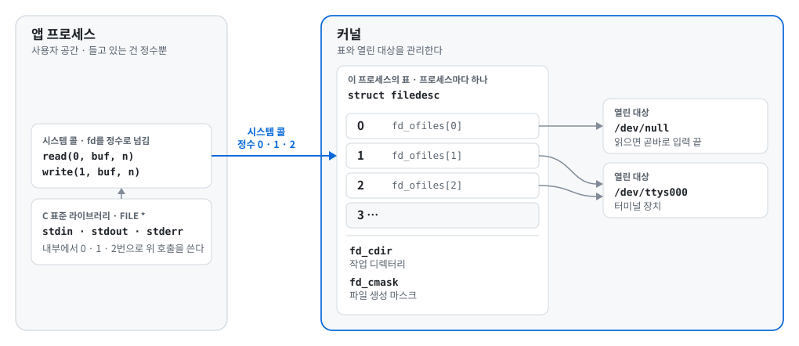

# 파일 디스크립터 (file descriptor, fd)

## 개요

프로세스가 이미 열어 둔 파일·장치·파이프 같은 대상을 가리킬 때 쓰는 정수 번호. 그 자체로는 주소도 장소도 아니고, 커널이 프로세스마다 관리하는 표의 **몇 번째 칸인지**를 나타낸다.

| 항목                | 내용                                                                        |
| ------------------- | --------------------------------------------------------------------------- |
| 종류                | 정수 (C의 `int`)                                                            |
| 번호를 들고 있는 곳 | 프로세스. 변수에 담아 두었다가 시스템 콜의 인자로 넘긴다                    |
| 표가 있는 곳        | 커널 안, 프로세스마다 하나 (XNU에서는 `struct filedesc`의 `fd_ofiles` 배열) |
| 번호가 통하는 범위  | 그 프로세스 안에서만                                                        |

## 용어

### 열린 대상

fd가 가리키는 끝. 일반 파일, 장치(`/dev/null`, 터미널 장치 `/dev/ttys000`), 파이프, 소켓 같은 것들이다. 커널 안에서는 표의 칸이 `fileproc`을 가리키고, `fileproc`이 열린 대상 자체인 `fileglob`으로 이어진다.

### 파일을 열다

경로로 대상을 찾아 권한을 확인한 뒤, 프로세스의 표에 칸을 하나 배정해 그 번호를 받는 일. `open()`이 번호를 반환하면 열린 상태이고, 그다음부터는 경로 대신 번호로 같은 대상에 접근한다.

### 표준 입력 · 표준 출력 · 표준 오류

0·1·2번 fd에 붙인 역할 이름. POSIX 규약에 따라 0번은 입력, 1번은 출력, 2번은 오류 출력에 쓴다. 0번에 어떤 대상이 연결되든 그 대상이 그 프로세스의 표준 입력이 된다.

"표준 입력"이라는 말에 관련된 층은 다음과 같다.

| 층        | 정체                                                                                            |
| --------- | ----------------------------------------------------------------------------------------------- |
| `stdin`   | C 표준 라이브러리의 스트림(`FILE *`). 내부에서 0번을 쓴다. `scanf()`도 이걸 거쳐 0번에서 읽는다 |
| 표준 입력 | 0번에 붙인 역할 이름                                                                            |
| `0`       | 정수. 표의 칸 번호                                                                              |
| 0번 칸    | 커널이 관리하는 항목. 열린 대상 하나를 가리킨다                                                 |
| 열린 대상 | 그 칸이 가리키는 끝. `/dev/null`, 터미널 장치, 일반 파일, 파이프 등                             |

"표준 입력에 파일을 연결한다"는 0번 칸이 그 파일의 열린 대상을 가리키게 한다는 뜻이다.

### 파일 생성 마스크 (umask)

프로세스마다 하나 있는 권한 비트 값. 파일을 새로 만들 때 커널은 요청받은 권한에서 마스크에 표시된 비트를 뺀다. `0666`을 요청했고 마스크가 `0022`면 파일은 처음부터 `0644`로 만들어진다. 프로세스를 실행하는 쪽이 `umask()` 한 번으로 그 프로세스가 만드는 모든 파일의 권한 상한을 정할 수 있다.

## 구조

<p align="center">
  
</p>

| 구성요소                      | 종류                                | 하는 일                                                     |
| ----------------------------- | ----------------------------------- | ----------------------------------------------------------- |
| fd (`0`, `1`, `2`, …)         | 정수                                | 표의 칸 번호. 시스템 콜의 인자로 넘긴다                     |
| `stdin` · `stdout` · `stderr` | C 표준 라이브러리 스트림 (`FILE *`) | 버퍼를 두고, 내부에서 0·1·2번으로 `read` · `write`를 부른다 |
| `struct filedesc`             | 커널 구조체 (프로세스마다 하나)     | fd 표와 작업 디렉터리, 파일 생성 마스크를 담는다            |
| `fd_ofiles`                   | 배열                                | fd 표 본체. i번 칸이 i번 fd다                               |
| `struct fileproc`             | 커널 구조체                         | 칸 하나가 가리키는 항목. 열린 대상(`fileglob`)으로 이어진다 |
| `struct fileglob`             | 커널 구조체                         | 열린 대상 자체                                              |

## 상태

| 무엇                        | 종류             | 어디에                     | 언제 생기나                                |
| --------------------------- | ---------------- | -------------------------- | ------------------------------------------ |
| fd 표 `fd_ofiles`           | 포인터 배열      | 커널, 프로세스(`proc`)마다 | 프로세스가 만들어질 때                     |
| 작업 디렉터리 `fd_cdir`     | 포인터           | 같은 `struct filedesc`     | 프로세스가 만들어질 때                     |
| 파일 생성 마스크 `fd_cmask` | 정수 (권한 비트) | 같은 `struct filedesc`     | 프로세스가 만들어질 때. `umask()`로 바뀐다 |
| fd 번호                     | 정수             | 프로세스의 변수            | `open()` 등이 반환할 때                    |

## 수명주기

fd 하나는 열기 → 사용 → 닫기 순으로 산다.

### 1. 열기: `open()`

```c
int open(const char *path, int oflag, ...);
```

커널이 경로를 해석하고 권한을 검사한 뒤, 표에서 비어 있는 가장 작은 번호를 골라 그 칸이 열린 대상을 가리키게 하고 번호를 반환한다. 파일을 새로 만드는 경우에는 요청한 권한에서 파일 생성 마스크를 뺀 권한으로 만든다.

### 2. 사용: `read()` · `write()`

```c
ssize_t read(int fd, void *buf, size_t nbyte);
```

커널이 호출한 프로세스의 표에서 `fd` 칸을 찾고, 그 칸이 가리키는 대상에서 최대 `nbyte`바이트를 `buf`에 넣은 뒤 실제로 읽은 바이트 수를 반환한다. 더 읽을 것이 없으면 `0`을 반환한다. "0번에서 읽는다"는 말은 `read()`의 첫 인자로 정수 `0`을 넘긴다는 뜻이다. `write()`는 방향만 반대다.

### 3. 닫기: `close()`

```c
int close(int fd);
```

칸을 비운다. 그 번호는 다음 `open()`에서 다른 대상에 다시 배정될 수 있다.

### 실행 전에 미리 배치하기

새 프로그램을 시작하기 전에 "이 번호가 이 대상을 가리키게 하라"는 지시를 [posix_spawn](posix_spawn.md)의 파일 작업 목록에 쌓아 둘 수 있다. 앱의 0·1·2번과 추가 번호들은 이렇게 앱 코드가 실행되기 전에 정해진다.

## 인터페이스

### fd를 다루는 호출

| 호출                                           | 하는 일                                                 |
| ---------------------------------------------- | ------------------------------------------------------- |
| `open(path, oflag)`                            | 대상을 열고 새 번호를 반환한다                          |
| `read(fd, buf, n)` · `write(fd, buf, n)`       | 그 번호가 가리키는 대상에서 읽고 쓴다                   |
| `close(fd)`                                    | 번호를 비운다                                           |
| `umask(mask)`                                  | 파일 생성 마스크를 바꾼다                               |
| `posix_spawn_file_actions_addopen`             | 새 프로세스의 특정 번호에 **경로로** 열 대상을 지정한다 |
| `posix_spawn_file_actions_add_fileportdup2_np` | 새 프로세스의 특정 번호에 **이미 열린 대상**을 붙인다   |

### 다른 프로세스로 넘기기

번호는 프로세스마다 다른 표를 가리키므로, 번호만 보내서는 받는 쪽에서 같은 대상을 가리킬 수 없다. 그래서 이미 열린 대상 자체에 대한 참조를 넘긴다.

- XPC 메시지에서는 `XPC_TYPE_FD` 타입의 값으로 넘긴다.
- 커널 쪽에서는 열린 파일을 Mach 포트로 감싼 **fileport**를 받아, 지정한 번호에 붙인다.

경로를 넘겨 "앞으로 열 파일"을 지정하는 `addopen`과, 참조를 넘겨 "이미 열린 대상"을 지정하는 `add_fileportdup2_np`는 이 점에서 다르다.

## 플랫폼 차이

0번 끝에 무엇이 붙는지는 실행 방식에 따라 다르다.

| 실행 방식                          | 0번            | 1번 · 2번       |
| ---------------------------------- | -------------- | --------------- |
| 시뮬레이터 앱을 `simctl`로 실행    | `/dev/null`    | (조회하지 않음) |
| 시뮬레이터 앱을 Xcode Run으로 실행 | `/dev/null`    | `/dev/ttys000`  |
| 터미널에서 실행한 `zsh`            | `/dev/ttys000` | (조회하지 않음) |
| 실기기에서 홈 화면으로 실행한 앱   | `/dev/null`    | `/dev/null`     |

앱의 0번이 `/dev/null`이라는 건 "이 앱에 표준 입력으로 줄 데이터는 없고, 읽으면 곧바로 입력 끝을 받는다"는 뜻이다. 반대로 Xcode 콘솔에 `print()` 출력이 보이는 건 1번이 터미널 장치에 연결돼 있기 때문이다. 터미널에서 실행한 프로그램은 0번 끝이 터미널 장치라서, 키보드로 입력한 문자를 읽는다.

## 미해결 질문

- fileport가 Mach 포트로서 전달되는 구체적인 과정
- 실기기 앱의 표를 직접 조회해도 위 표와 같은지

## 관련 문서

- 노드
  - [xpcproxy](xpcproxy.md): 앱의 0·1·2번과 추가 번호들이 무엇을 가리킬지 지시를 쌓는다.
  - [posix_spawn](posix_spawn.md): 그 지시를 담아 넘기는 파일 작업 목록.
  - [launchd](launchd.md): 이미 열린 대상을 응답의 `fds` 배열로 넘긴다.
  - [커널의 spawn 처리](posix_spawn-kernel.md): 이 표를 들고 있는 `proc`이 만들어지고, 쌓인 지시가 적용되는 곳.
- 경로
  - [앱 실행: 터치 → AppDelegate.init()](../paths/app-launch.md)

## 참고 문헌

### 공개 소스

[xnu-12377.1.9](https://github.com/apple-oss-distributions/xnu/tree/xnu-12377.1.9) 기준.

- `bsd/sys/filedesc.h`: `struct filedesc` [L121](https://github.com/apple-oss-distributions/xnu/blob/xnu-12377.1.9/bsd/sys/filedesc.h#L121), `fd_cmask` [L125](https://github.com/apple-oss-distributions/xnu/blob/xnu-12377.1.9/bsd/sys/filedesc.h#L125), `fd_ofiles` [L143](https://github.com/apple-oss-distributions/xnu/blob/xnu-12377.1.9/bsd/sys/filedesc.h#L143), `fd_cdir` [L149](https://github.com/apple-oss-distributions/xnu/blob/xnu-12377.1.9/bsd/sys/filedesc.h#L149)
- `bsd/sys/file_internal.h`: `fileproc` [L120](https://github.com/apple-oss-distributions/xnu/blob/xnu-12377.1.9/bsd/sys/file_internal.h#L120) → `fp_glob` [L125](https://github.com/apple-oss-distributions/xnu/blob/xnu-12377.1.9/bsd/sys/file_internal.h#L125)
- `bsd/kern/kern_exec.c`: 파일 작업을 적용할 때의 마스크 계산 [L2994](https://github.com/apple-oss-distributions/xnu/blob/xnu-12377.1.9/bsd/kern/kern_exec.c#L2994), `PSFA_FILEPORT_DUP2` 처리 [L3050](https://github.com/apple-oss-distributions/xnu/blob/xnu-12377.1.9/bsd/kern/kern_exec.c#L3050)

### 표준 문서

- [POSIX `unistd.h`](https://www.man7.org/linux/man-pages/man0/unistd.h.0p.html): 0·1·2번을 표준 입력·출력·오류로 쓰는 규약
- POSIX [`open`](https://pubs.opengroup.org/onlinepubs/9699919799/functions/open.html), [`read`](https://pubs.opengroup.org/onlinepubs/9699919799/functions/read.html), [`close`](https://pubs.opengroup.org/onlinepubs/9699919799/functions/close.html)

### 실측

- 시뮬레이터 앱(`simctl`, Xcode Run)과 터미널 `zsh`의 0·1·2번이 가리키는 대상 조회
- XPC 메시지에서 fd가 `XPC_TYPE_FD` 값으로 오가는 것
