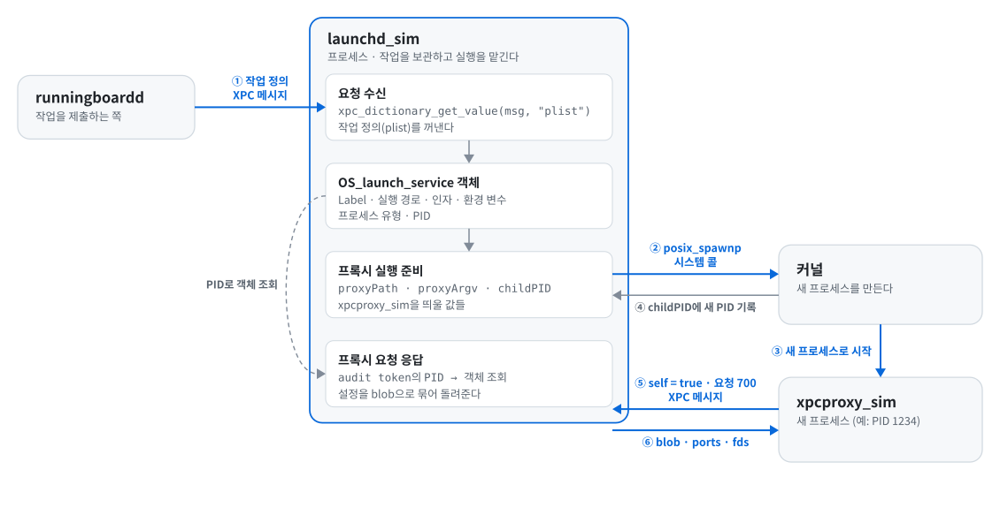

# launchd

## 개요

작업(job) 정의를 받아 보관하고, 그 작업을 실행할 프로세스를 만들어 내는 서비스 관리자. 부팅할 때 커널이 처음 띄우는 사용자 공간 프로세스이고, 앱을 실행할 때는 앱을 직접 띄우지 않고 보조 프로그램 xpcproxy를 먼저 띄운다.

| 항목       | 내용                                                                                                            |
| ---------- | --------------------------------------------------------------------------------------------------------------- |
| 종류       | 프로세스 (서비스 관리자)                                                                                        |
| 실행 영역  | 사용자 공간                                                                                                     |
| 위치       | macOS · iOS: `/sbin/launchd`, PID 1                                                                             |
| 시뮬레이터 | 런타임 루트의 `sbin/launchd_sim`. 호스트 macOS 위에서 일반 프로세스로 실행되고, 시뮬레이터 기기마다 하나씩 있다 |

## 용어

### 작업 (job)

launchd가 관리하는 실행 단위. "무엇을, 어떤 설정으로 실행할지"의 정의이고, `Label`이라는 고유 이름으로 구분한다. 실행 파일 경로, 인자, 환경 변수, 작업 디렉터리, 표준 입출력 파일 같은 설정을 키-값으로 담는다.

### 작업 정의 (`plist`)

작업을 요청할 때 함께 보내는 XPC 딕셔너리. 위의 설정 키들이 들어 있고, 요청자(예: runningboardd)가 만든다.

### `OS_launch_service`

launchd가 작업 하나를 관리하려고 만드는 Objective-C 객체. 작업 정의에서 읽은 값과, 그 작업을 맡은 프로세스의 PID를 담는다.

### 프록시 (xpcproxy)

launchd가 대상 프로그램을 실행하기 전에 먼저 띄우는 보조 프로그램. 새 프로세스 안에서 작업 디렉터리 · 입출력 · 포트 같은 설정을 적용한 뒤, 같은 PID에서 대상 프로그램으로 바뀐다. 자세한 것은 [xpcproxy](xpcproxy.md).

### audit token

메시지를 받을 때 커널이 붙여 주는 발신자 정보. 보낸 프로세스의 PID 등이 들어 있고, 보내는 쪽이 직접 적는 값이 아니다.

## 책임

- **작업 받기**: XPC 메시지로 온 작업 정의를 읽는다.
- **작업 보관**: 작업마다 `OS_launch_service` 객체를 만들어 설정을 담아 둔다.
- **프로세스 띄우기**: `posix_spawnp`로 xpcproxy를 새 프로세스로 띄우고, 그 PID를 작업에 연결한다.
- **설정 돌려주기**: 띄운 xpcproxy가 자기 설정을 물으면, 해당 작업의 설정을 묶어 응답한다.

## 구조

<p align="center">
  
</p>

| 구성요소                                                                          | 종류                                 | 하는 일                                          |
| --------------------------------------------------------------------------------- | ------------------------------------ | ------------------------------------------------ |
| `OS_launch_service`                                                               | Objective-C 클래스 (`NSObject` 하위) | 작업 하나의 설정과 맡은 PID를 담는 객체의 클래스 |
| `xpc_dictionary_get_value` · `xpc_dictionary_get_string` · `xpc_array_get_string` | libxpc C 함수                        | 받은 XPC 딕셔너리에서 값을 꺼낸다                |
| `class_createInstance`                                                            | Objective-C 런타임 C 함수            | `OS_launch_service` 인스턴스를 만든다            |
| `posix_spawnp`                                                                    | C 함수 (시스템 콜을 쓰는 API)        | xpcproxy를 새 프로세스로 띄운다                  |

## 상태

| 무엇                         | 종류             | 어디에         | 언제 생기나                               |
| ---------------------------- | ---------------- | -------------- | ----------------------------------------- |
| 작업마다 `OS_launch_service` | Objective-C 객체 | launchd 메모리 | 작업 실행 요청을 받았을 때 (수명주기 · 3) |

객체 하나가 담는 값은 다음과 같다.

| 보관하는 값   | 형태                                      | 채워지는 시점      |
| ------------- | ----------------------------------------- | ------------------ |
| `Label`       | 객체 메모리에 복사한 문자열               | 객체를 만들 때     |
| 실행 경로     | 경로를 보관하는 별도 객체의 참조          | 객체를 만들 때     |
| 실행 인자     | 개수 + 목록 포인터 (문자열은 별도 메모리) | 객체를 만들 때     |
| 환경 변수     | 연결 목록의 첫 항목 포인터                | 객체를 만들 때     |
| 프로세스 유형 | 숫자 (`"App"` → `0x100`)                  | 객체를 만들 때     |
| PID           | 정수                                      | 프록시를 띄운 직후 |

무엇을 어떻게 실행할지는 프로세스를 띄우기 전에 이미 들어 있고, 어느 PID가 그 작업을 맡았는지는 띄운 뒤에 추가된다.

## 수명주기

작업 하나는 받기 → 보관 → 프록시 띄우기 → PID 연결 → 설정 응답 순으로 처리된다. 순서와 동작은 `launchd_sim` 바이너리를 분석해 얻은 것이다.

### 1. 작업 정의를 꺼낸다

```c
xpc_object_t plist = xpc_dictionary_get_value(message, "plist");
```

작업 실행을 요청하는 XPC 메시지가 도착하면, 받은 바깥 딕셔너리(`message`)에서 `"plist"` 키로 안쪽 딕셔너리(작업 정의)를 꺼낸다. 꺼낸 값이 딕셔너리인지 확인하고, `Label`을 읽어 어떤 작업인지 식별한다.

### 2. 실행할 파일의 경로를 정한다

1. `xpc_dictionary_get_string(plist, "Program")`으로 `Program` 값을 찾는다.
2. 없으면 `ProgramArguments`가 비어 있지 않은 배열인지 확인하고, `xpc_array_get_string(programArguments, 0)`으로 0번 문자열을 꺼낸다. 예를 들어 `["/Apps/MyApp.app/MyApp", "--demo"]`면 첫 값이 실행 대상이고, `--demo`는 앱에 줄 인자다.
3. 경로를 검사한다. 첫 글자가 `/`인지 보고, 시뮬레이터 설정에 따라 런타임 루트 경로를 앞에 붙인다. 실패하면 오류로 끝낸다.

여기서 손에 쥐는 건 최종적으로 띄울 **대상 프로그램**(앱)의 실행 파일 경로다. 어떤 앱을 열지는 이미 정해져 있고, 여기서는 그 실행 파일의 위치를 작업 정의에서 얻는다.

### 3. `OS_launch_service` 객체를 만든다

프록시를 띄우기 **전에** `class_createInstance`로 인스턴스를 만들고, 읽은 값을 형태별로 다르게 넣는다.

| 값                     | 넣는 방식                                                               |
| ---------------------- | ----------------------------------------------------------------------- |
| `Label`                | 문자열을 객체 자체의 메모리에 **복사**                                  |
| 실행 경로              | 경로 정보를 보관하는 별도 객체를 두고, 그 객체의 **참조**를 넣음        |
| 실행 인자              | 문자열들을 별도 메모리에 복사하고, **개수와 목록의 포인터**를 넣음      |
| `EnvironmentVariables` | 키와 값을 하나씩 순회해 연결 목록을 만들고, **첫 항목의 포인터**를 넣음 |
| `ProcessType`          | 문자열을 숫자로 바꿔 넣음. `"App"`은 `0x100`, `"Driver"`는 `0x700`      |

launchd 메모리에 이 작업을 나타내는 객체가 하나 생긴다. PID 자리만 비어 있다.

### 4. 프록시의 경로와 인자를 만든다

| 값          | 내용                                                                                                         |
| ----------- | ------------------------------------------------------------------------------------------------------------ |
| `proxyPath` | 시뮬레이터 런타임 루트(`…/iOS 26.1.simruntime/Contents/Resources/RuntimeRoot`) + `/usr/libexec/xpcproxy_sim` |
| `proxyArgv` | `["xpcproxy_sim", <Label>, NULL]`. `argv[1]`의 `Label`이 "어느 작업을 위한 실행인지"를 프록시에 알려 준다    |

이제 경로 두 개를 들고 있다. 2에서 정한 건 **최종적으로 띄울 앱**, 여기서 만든 건 **먼저 띄울 xpcproxy_sim**이다. 런타임 루트를 붙이는 건 Mac에 시뮬레이터 런타임(18.5, 26.1 …)이 여러 개 있을 수 있어서, 현재 런타임 폴더가 xpcproxy_sim 경로의 앞부분을 정하기 때문이다. `proxyArgv`는 앱에 줄 `ProgramArguments`와 별개다. 앱의 인자는 나중에 xpcproxy가 launchd에 물어서 받는다.

### 5. `posix_spawnp`로 프록시를 띄운다

```c
pid_t childPID = 0;
posix_spawnp(&childPID, proxyPath, &fileActions, &spawnAttrs, proxyArgv, envp);
```

| 인자                | 뜻                                                                                                                         |
| ------------------- | -------------------------------------------------------------------------------------------------------------------------- |
| `&childPID`         | 호출 스레드 **자기 스택**에 있는 4바이트 자리의 주소. 먼저 0을 써 두고 넘긴다. "새 PID가 정해지면 여기 적어 달라"는 뜻이다 |
| `proxyPath`         | 4에서 만든 xpcproxy_sim 경로                                                                                               |
| `&fileActions`      | 파일 작업 목록                                                                                                             |
| `&spawnAttrs`       | 실행 속성. 프로세스 유형은 최종 대상이 무엇이든 `0x400`                                                                    |
| `proxyArgv`, `envp` | 프록시에 줄 인자와 환경                                                                                                    |

같은 스레드가 커널로 들어가 새 프로세스를 만든다([커널의 spawn 처리](posix_spawn-kernel.md)). 성공하면 `0`을 반환하고, 커널이 `&childPID` 자리에 새 xpcproxy_sim의 PID(예: `1234`)를 써 둔다. **주소는 그대로이고 값만 0 → 1234로 바뀐다.** `&childPID`는 PID를 발급하는 무언가의 주소가 아니라, 발급된 PID 숫자를 적을 자리의 주소다.

새 프로세스에서는 xpcproxy_sim의 코드가 따로 출발하고, launchd의 스레드는 호출 다음 줄로 돌아온다.

### 6. PID를 객체에 기록한다

스택의 그 자리를 다시 읽어 3에서 만든 객체의 PID 칸에 쓴다. 의미만 C로 옮기면 `service->pid = childPID;`다. 객체에 복사되는 건 변수의 주소가 아니라 그 자리에 들어 있던 **숫자**다. 이제 같은 객체가 "어떤 작업인지"와 "어느 프로세스가 그 작업을 맡았는지"를 함께 가진다.

### 7. 프록시의 요청이 어느 작업인지 알아낸다

방금 띄운 xpcproxy_sim은 시작하자마자 XPC 요청을 보낸다.

| 요청의 부분 | 내용                                                                                                   |
| ----------- | ------------------------------------------------------------------------------------------------------ |
| 딕셔너리 안 | `self = true` (이 요청은 보내는 프로세스 **자신**에 관한 것). 조건에 따라 `pre-exec = true`가 추가된다 |
| 딕셔너리 밖 | 전송 함수의 별도 인자로 요청 번호 `0x2bc`(700). 이 번호가 "무슨 요청인가"를 정한다                     |

프록시는 자기 PID나 앱 경로를 직접 적지 않는다. 의미는 "내가 어떤 앱으로 전환해야 하는지, 어떤 인자 · 환경으로 시작해야 하는지 알려 달라"다. launchd는 이렇게 처리한다.

1. `self = true`를 읽는다.
2. 메시지의 audit token에서 PID를 읽는다.
3. 그 PID로 6에서 기록한 객체를 찾는다.

PID의 역할은 **어느 작업인지 고르는 것**까지다. 나머지 설정은 그렇게 찾은 객체가 3부터 보관하던 것이다.

### 8. 설정을 묶어 응답한다

찾은 객체에서 실행 경로, 인자 목록, 환경 변수 등을 읽어 정해진 형식의 바이트 덩어리로 묶고, XPC 응답 딕셔너리의 `blob` 키에 담는다. 같은 딕셔너리에 `ports`와 `fds` 배열도 별도 키로 담는다. 응답을 받은 뒤의 일은 [xpcproxy](xpcproxy.md)에 있다.

## 인터페이스

| 방향 | 상대                       | 수단                       | 오가는 것                                    |
| ---- | -------------------------- | -------------------------- | -------------------------------------------- |
| 입력 | 요청자 (예: runningboardd) | XPC 메시지                 | 작업 정의 `plist`                            |
| 출력 | 커널                       | 시스템 콜 (`posix_spawnp`) | xpcproxy 경로 · 인자 · 파일 작업 · 실행 속성 |
| 입력 | xpcproxy                   | XPC 메시지 (요청 700)      | `self = true`, 발신자 정보(audit token)      |
| 출력 | xpcproxy                   | XPC 응답                   | `blob`, `ports`, `fds`                       |

### 작업 설정 키

launchd 작업 설정의 공개된 키와, 프록시 쪽에서 본 동작을 짝지은 표다. 오른쪽 열은 키의 의미와 동작을 맞춰 본 것이다.

| 설정 키                                                  | 의미                        | 대응하는 동작                                  |
| -------------------------------------------------------- | --------------------------- | ---------------------------------------------- |
| `Label`                                                  | 작업의 고유 이름            | `OS_launch_service`에 복사, 프록시의 `argv[1]` |
| `Program`, `ProgramArguments`                            | 실행 파일 경로와 인자       | 앱 쪽 `posix_spawn`의 `path`, `argv`           |
| `EnvironmentVariables`                                   | 환경 변수                   | `envp`                                         |
| `WorkingDirectory`                                       | 작업 디렉터리               | 경로 조합의 기준, 이후 `chdir()`               |
| `StandardInPath`, `StandardOutPath`, `StandardErrorPath` | 0·1·2번에 연결할 파일       | 열기 지시 등록                                 |
| `Umask`                                                  | 파일 생성 권한 마스크       | `umask()`                                      |
| `LowPriorityIO`, `LowPriorityBackgroundIO`               | 디스크 입출력 우선순위 낮춤 | `setiopolicy_np()`                             |
| `ProcessType`                                            | 프로세스 유형               | 숫자로 변환해 저장                             |

공개 문서의 `ProcessType` 값은 `Background`, `Standard`, `Adaptive`, `Interactive`인데, `launchd_sim`은 `"App"`, `"Driver"`도 처리한다.

## 플랫폼 차이

|               | 시뮬레이터                                                                                       | 실기기           |
| ------------- | ------------------------------------------------------------------------------------------------ | ---------------- |
| 프로그램      | `launchd_sim`. 호스트 macOS 위의 일반 프로세스이고, 시뮬레이터 기기마다 하나 (두 대를 띄우면 둘) | `launchd`, PID 1 |
| 띄우는 프록시 | `xpcproxy_sim` (런타임 루트를 앞에 붙인 경로)                                                    | `xpcproxy`       |
| 작업 디렉터리 | `/` (조회한 두 대 모두)                                                                          | 확인하지 않음    |

## 미해결 질문

- `blob`의 전체 레이아웃과 `OS_launch_service`의 나머지 필드
- `pre-exec = true`가 붙는 조건
- 실기기 `launchd`도 같은 클래스 · 같은 순서로 동작하는지

## 관련 문서

- 노드
  - [runningboardd](runningboardd.md): 작업을 제출하는 쪽.
  - [xpcproxy](xpcproxy.md): launchd가 띄우는 보조 프로그램. 자기 설정을 launchd에 되묻는다.
  - [posix_spawn](posix_spawn.md): launchd가 프록시를 띄울 때 쓰는 호출(`posix_spawnp`).
  - [커널의 spawn 처리](posix_spawn-kernel.md): `posix_spawnp`를 받은 커널이 하는 일.
  - [파일 디스크립터](file-descriptor.md): 응답의 `fds` 배열로 이미 열린 대상을 넘긴다.
- 경로
  - [앱 실행: 터치 → AppDelegate.init()](../paths/app-launch.md)

## 참고 문헌

### 바이너리 분석

iOS 26.1 시뮬레이터 런타임의 `launchd_sim`.

- 수명주기 1~8의 순서와 호출
- `OS_launch_service`의 클래스와 필드, 값을 넣는 방식
- `ProcessType`의 `"App"` → `0x100`, `"Driver"` → `0x700`, 프록시 실행 속성의 `0x400`
- 프록시 요청의 `self = true`, `pre-exec`, 요청 번호 700, audit token으로 작업 찾기, `blob` · `ports` · `fds` 응답
- 시뮬레이터 두 대에서 `launchd_sim`이 둘이고 작업 디렉터리가 `/`라는 것

### 문서

- `man 8 launchd`: macOS에서 `/sbin/launchd`가 PID 1로 실행된다는 것
- `man 5 launchd.plist`: 작업 설정 키의 의미, 공개된 `ProcessType` 값
- [launchd-842.92.1](https://github.com/apple-oss-distributions/launchd/tree/launchd-842.92.1): launchd의 마지막 공개 소스. 현재 구현은 소스로 대조할 수 없다
