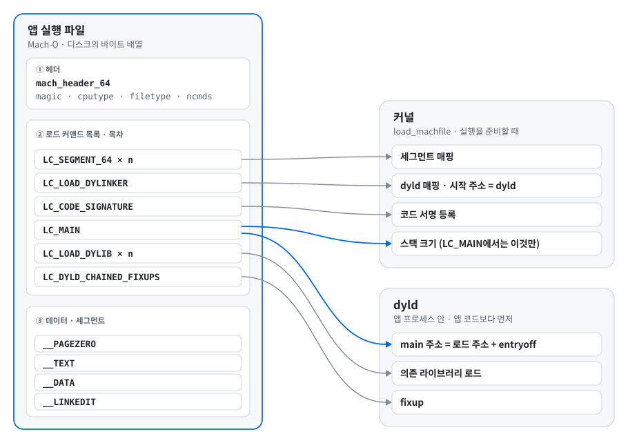

# Mach-O (Mach object file format)

## 개요

Apple 플랫폼의 실행 파일 형식. 앱 실행 파일, 동적 라이브러리, dyld 자신이 모두 이 형식이다. "이 파일을 메모리에 어떻게 올리고 어디서부터 실행할지"를 적어 둔 목차와 내용이고, 동작하는 건 이 파일을 읽는 커널과 dyld다.

| 항목       | 내용                                                 |
| ---------- | ---------------------------------------------------- |
| 종류       | 파일 형식                                            |
| 디스크에서 | 바이트 배열                                          |
| 실행될 때  | 일부가 세그먼트 단위로 프로세스 주소 공간에 매핑된다 |
| 정의       | `<mach-o/loader.h>`                                  |
| 읽는 쪽    | 커널(실행을 준비할 때), dyld(앱 코드가 실행되기 전)  |

## 용어

### 로드 커맨드

헤더 바로 뒤에 이어지는 목차 항목. 모든 로드 커맨드는 종류(`cmd`)와 크기(`cmdsize`)로 시작하고, 종류마다 담긴 내용이 다르다. 커널과 dyld는 이 목록을 처음부터 순서대로 훑으며 자기에게 필요한 종류만 골라 쓴다.

### 세그먼트와 섹션

- **세그먼트**: 같은 권한으로 메모리에 올라가는 파일 구간의 단위. `__TEXT`, `__DATA` 같은 이름을 가진다.
- **섹션**: 세그먼트 안을 내용별로 더 나눈 구간. 예를 들어 코드는 `__TEXT` 세그먼트의 `__text` 섹션에 있고, Objective-C 클래스 정보도 별도 섹션으로 들어 있다.

### 매핑

파일의 구간을 주소 공간의 주소 범위에 연결하는 일. 그 주소로 접근하면 파일의 해당 바이트를 쓸 수 있게 되고, 실제 바이트는 접근할 때 채워진다. 커널이 실제로 매핑하는 과정은 [커널의 spawn 처리](posix_spawn-kernel.md) 3에 있다.

### 오프셋과 로드 주소

- **오프셋**: 파일이나 이미지의 시작점으로부터의 거리. 실행 파일은 실행할 때마다 다른 주소에 올라갈 수 있어서(PIE), 파일 안의 위치는 대부분 오프셋으로 적는다.
- **로드 주소**: 이미지가 실제로 올라간 시작 주소. 실제 주소는 `로드 주소 + 오프셋`으로 계산한다. `LC_MAIN`의 `entryoff`가 대표적인 예다.

## 구조

  

파일은 **헤더 → 로드 커맨드 목록 → 데이터** 순으로 이어진다. 화살표는 어느 로드 커맨드가 어디에 쓰이는지다. 파란 화살표는 `LC_MAIN` 하나가 두 독자에게 서로 다른 값을 주는 모습이다. 로드 커맨드의 순서는 설명을 위해 커널이 쓰는 것과 dyld가 쓰는 것으로 묶어 놓은 것이고, 실제 파일의 순서와는 다를 수 있다.

### 헤더 (`mach_header_64`)

| 필드                    | 내용                                                                                                    |
| ----------------------- | ------------------------------------------------------------------------------------------------------- |
| `magic`                 | 형식 식별 값. 64비트는 `0xfeedfacf`                                                                     |
| `cputype`, `cpusubtype` | 대상 CPU                                                                                                |
| `filetype`              | 파일의 종류. 실행 파일 `MH_EXECUTE`(0x2), 동적 라이브러리 `MH_DYLIB`(0x6), 동적 링커 `MH_DYLINKER`(0x7) |
| `ncmds`, `sizeofcmds`   | 뒤따르는 로드 커맨드의 개수와 총 크기                                                                   |
| `flags`                 | `MH_PIE` 등                                                                                             |

### 앱 실행에 관여하는 로드 커맨드

| 커맨드                   | 담긴 정보                                                         |
| ------------------------ | ----------------------------------------------------------------- |
| `LC_SEGMENT_64`          | 파일의 어느 구간을 메모리 어느 주소에 어떤 권한으로 올릴지        |
| `LC_LOAD_DYLINKER`       | 이 프로그램을 시작시킬 동적 링커의 경로 (`/usr/lib/dyld`)         |
| `LC_CODE_SIGNATURE`      | 코드 서명의 위치                                                  |
| `LC_MAIN`                | `entryoff`(진입 함수의 파일 오프셋)와 초기 스택 크기(`stacksize`) |
| `LC_LOAD_DYLIB`          | 의존하는 동적 라이브러리                                          |
| `LC_DYLD_CHAINED_FIXUPS` | 로드 후 고쳐 써야 할 포인터들의 위치                              |
| `LC_BUILD_VERSION`       | 대상 플랫폼과 최소 OS 버전. iOS는 2, iOS 시뮬레이터는 7           |
| `LC_UUID`                | 빌드 식별자                                                       |

### 세그먼트

| 세그먼트       | 권한                         | 내용                                                      |
| -------------- | ---------------------------- | --------------------------------------------------------- |
| `__PAGEZERO`   | 접근 불가                    | 주소 0 근처를 막아 두는 영역. NULL 포인터 접근을 잡아낸다 |
| `__TEXT`       | 읽기 · 실행                  | 코드와 읽기 전용 데이터                                   |
| `__DATA_CONST` | 읽기 (fixup하는 동안만 쓰기) | fixup 뒤로는 바뀌지 않는 포인터 데이터                    |
| `__DATA`       | 읽기 · 쓰기                  | 쓰기 가능한 데이터. 전역 변수 등                          |
| `__LINKEDIT`   | 읽기                         | 링커가 쓰는 표들 (심볼, fixup 정보, 코드 서명 등)         |

fixup으로 고쳐 쓰는 포인터는 `__DATA_CONST`와 `__DATA`에 있다.

Objective-C 클래스 정보도 이 파일 안의 섹션으로 들어 있어서, 파일만 읽어도 클래스 이름과 상위 클래스를 알아낼 수 있다.

## 수명주기

Mach-O 파일은 빌드할 때 만들어지고, 실행할 때 커널 → dyld 순으로 두 번 읽힌다.

### 1. 만들어진다

빌드의 마지막 단계에서 링커가 컴파일된 코드와 데이터를 세그먼트로 배치하고, 헤더와 로드 커맨드를 앞에 붙여 파일을 만든다. 이때 라이브러리의 실제 주소는 정해지지 않으므로, 다른 라이브러리를 가리킬 자리와 고쳐 쓸 포인터의 위치만 적어 둔다.

### 2. 커널이 읽는다

[커널의 spawn 처리](posix_spawn-kernel.md) 3에서 `load_machfile()`이 이 파일을 읽는다. `filetype`을 확인하고, 로드 커맨드를 순회하며 세그먼트를 매핑하고, 코드 서명을 등록하고, `LC_LOAD_DYLINKER`가 있으면 그 경로의 동적 링커도 같은 주소 공간에 매핑한다.

커널은 `LC_MAIN`의 `entryoff`를 쓰지 않는다. 가져가는 건 스택 크기와 "이 프로그램은 동적 링커가 필요하다"는 사실뿐이다. 소스 주석이 이를 직접 말한다: _"kernel does not use entryoff from LC_MAIN. Dyld uses it."_ 그래서 커널이 정하는 시작 주소는 앱의 `main`이 아니라 동적 링커의 진입점이다. 동적 링커를 매핑한 결과의 진입점이 전체 결과의 진입점을 덮어쓴다.

### 3. dyld가 읽는다

[dyld](dyld.md)가 앱 프로세스 안에서, 커널이 매핑해 둔 헤더와 로드 커맨드를 메모리에서 다시 읽는다. `LC_LOAD_DYLIB`로 의존 라이브러리를 찾아 로드하고, `LC_DYLD_CHAINED_FIXUPS`가 가리키는 포인터들을 고친다. 마지막으로 `LC_MAIN`에서 `entryoff`를 꺼내 앱 실행 파일의 로드 주소에 더해 진입 함수의 주소를 만들고, 그 함수를 호출한다.

## 인터페이스

같은 파일을 두 쪽이 따로 읽고, 서로 다른 로드 커맨드를 가져간다.

| 읽는 쪽 | 가져가는 것                                                                           | 결과                                                         |
| ------- | ------------------------------------------------------------------------------------- | ------------------------------------------------------------ |
| 커널    | `LC_SEGMENT_64`, `LC_LOAD_DYLINKER`, `LC_CODE_SIGNATURE`, `LC_MAIN`의 `stacksize`     | 실행 파일과 dyld가 매핑된 주소 공간, 시작 주소 = dyld 진입점 |
| dyld    | `LC_LOAD_DYLIB`, `LC_DYLD_CHAINED_FIXUPS`, `LC_BUILD_VERSION`, `LC_MAIN`의 `entryoff` | 연결된 라이브러리들, 고쳐 쓴 포인터, 진입 함수 주소          |

## 관련 문서

- 노드
  - [커널의 spawn 처리](posix_spawn-kernel.md): 이 형식의 첫 번째 독자. 세그먼트와 dyld를 매핑한다.
  - [dyld](dyld.md): 이 형식의 두 번째 독자. dyld 자신도 `MH_DYLINKER` 종류의 Mach-O다.
  - [posix_spawn](posix_spawn.md): 커널이 이 파일을 읽게 되는 계기.
- 경로
  - [앱 실행: 터치 → AppDelegate.init()](../paths/app-launch.md)

## 참고 문헌

### 공개 소스

[xnu-12377.1.9](https://github.com/apple-oss-distributions/xnu/tree/xnu-12377.1.9), [dyld-1378](https://github.com/apple-oss-distributions/dyld/tree/dyld-1378) 기준.

- xnu `EXTERNAL_HEADERS/mach-o/loader.h`: `mach_header_64` [L72](https://github.com/apple-oss-distributions/xnu/blob/xnu-12377.1.9/EXTERNAL_HEADERS/mach-o/loader.h#L72), 파일 종류 [L111](https://github.com/apple-oss-distributions/xnu/blob/xnu-12377.1.9/EXTERNAL_HEADERS/mach-o/loader.h#L111), 로드 커맨드 상수 [L261](https://github.com/apple-oss-distributions/xnu/blob/xnu-12377.1.9/EXTERNAL_HEADERS/mach-o/loader.h#L261), 세그먼트 이름 [L589](https://github.com/apple-oss-distributions/xnu/blob/xnu-12377.1.9/EXTERNAL_HEADERS/mach-o/loader.h#L589), 플랫폼 값 [L1277](https://github.com/apple-oss-distributions/xnu/blob/xnu-12377.1.9/EXTERNAL_HEADERS/mach-o/loader.h#L1277), `entry_point_command` [L1530](https://github.com/apple-oss-distributions/xnu/blob/xnu-12377.1.9/EXTERNAL_HEADERS/mach-o/loader.h#L1530)
- xnu `bsd/kern/mach_loader.c`: `parse_machfile` [L1048](https://github.com/apple-oss-distributions/xnu/blob/xnu-12377.1.9/bsd/kern/mach_loader.c#L1048), 커맨드별 분기 [L1455](https://github.com/apple-oss-distributions/xnu/blob/xnu-12377.1.9/bsd/kern/mach_loader.c#L1455), `load_main` [L2822](https://github.com/apple-oss-distributions/xnu/blob/xnu-12377.1.9/bsd/kern/mach_loader.c#L2822), `load_dylinker`의 진입점 덮어쓰기 [L3277](https://github.com/apple-oss-distributions/xnu/blob/xnu-12377.1.9/bsd/kern/mach_loader.c#L3277)
- dyld `mach_o/UnsafeHeader.cpp`: `getEntry` [L1487](https://github.com/apple-oss-distributions/dyld/blob/dyld-1378/mach_o/UnsafeHeader.cpp#L1487)
- dyld `dyld/dyldMain.cpp`: 진입 주소 계산 [L1033](https://github.com/apple-oss-distributions/dyld/blob/dyld-1378/dyld/dyldMain.cpp#L1033)

### 분석

- `launchd_sim`을 `llvm-objdump --macho --objc-meta-data`로 덤프해 `OS_launch_service` 클래스와 상위 클래스 확인
