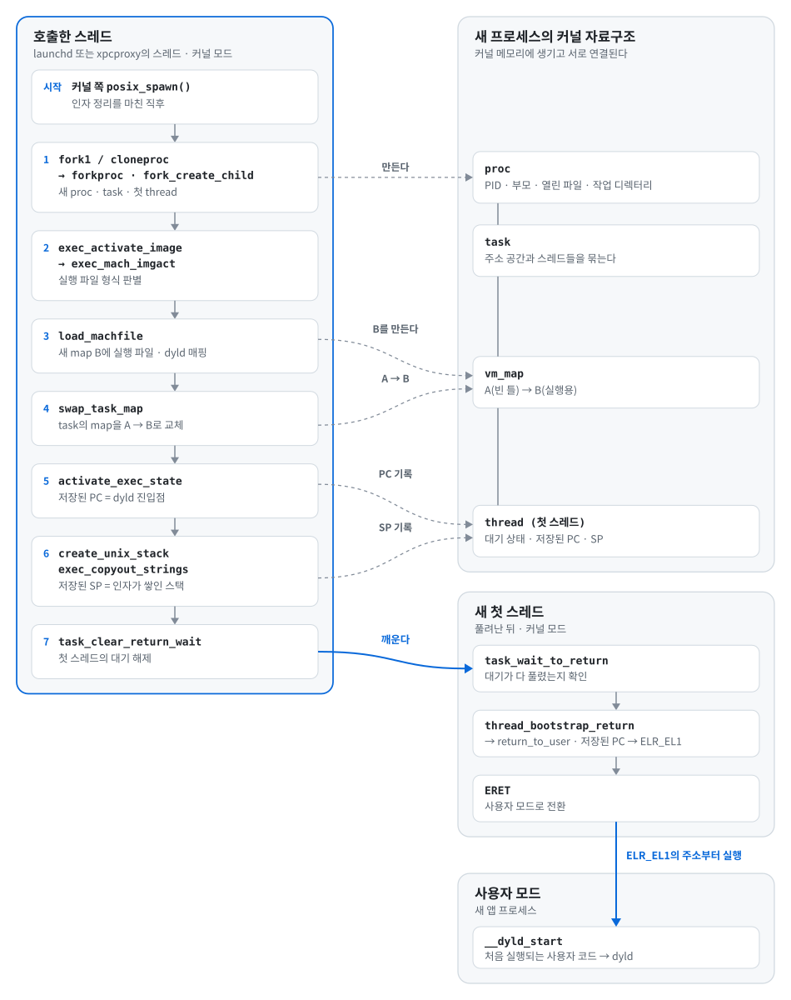

# 커널의 spawn 처리

## 개요

커널 쪽 `posix_spawn()`이 요청을 받은 뒤, 새 프로세스의 커널 자료구조를 만들고, 실행 파일과 dyld를 새 주소 공간에 매핑하고, 첫 스레드가 dyld에서 출발하도록 저장된 PC·SP를 맞춰 풀어 주기까지의 처리.

| 항목            | 내용                                                                                                                               |
| --------------- | ---------------------------------------------------------------------------------------------------------------------------------- |
| 종류            | 커널 함수들의 흐름. 객체 하나가 아니라, 그 결과로 커널 메모리에 자료구조 여러 개가 생기고 서로 연결된다                            |
| 실행하는 스레드 | 호출한 쪽(launchd 또는 xpcproxy)의 스레드가 커널 모드에서 실행한다. 새 앱의 첫 스레드는 따로 만들어져 기다리다가 마지막에 출발한다 |
| 시작점          | 커널 쪽 `posix_spawn()`이 인자 정리를 마친 직후 ([posix_spawn](posix_spawn.md) 4번)                                                |
| 끝점            | 새 첫 스레드가 `ERET`으로 사용자 모드에 들어가 `__dyld_start`에 도착 ([dyld](dyld.md))                                             |

## 용어

### 커널 모드

CPU가 커널 코드를 실행하는 특권 상태. 시스템 콜을 부른 스레드는 이 상태로 바뀌어 커널 코드를 실행하고, 끝나면 사용자 모드로 돌아온다. 아래 1~7은 호출한 스레드가 커널 모드에서 실행한다.

### `proc`과 `task`

한 프로세스를 관리하는 커널 구조체 두 가지. `proc`은 BSD 쪽 구조체로 PID · 부모 · 열린 파일 같은 유닉스식 정보를, `task`는 Mach 쪽 구조체로 주소 공간과 스레드들을 맡는다.

### 매핑

파일의 구간을 주소 공간의 주소 범위에 연결하는 일. 매핑된 주소에 처음 접근할 때 그 페이지가 아직 RAM에 없으면 **page fault**가 나고, 그때 커널이 물리 페이지를 확보해 파일 내용을 채운다. 그래서 매핑된 상태와 RAM에 올라와 있는 상태는 다르다. UIKit이나 dyld의 기계어처럼 읽기 전용인 코드 페이지는 여러 프로세스가 같은 물리 페이지를 각자의 가상 주소로 가리켜 함께 쓴다.

### copy-on-write

여러 쪽이 같은 페이지를 함께 쓰다가, 어느 한쪽이 그 페이지에 쓰기를 할 때 그 페이지만 쓰는 쪽 전용 복사본으로 만드는 방식. 처음부터 전부 복사하지 않아도 된다.

### map A와 map B

|       | 언제 생기나       | 정체                                                                                  |
| ----- | ----------------- | ------------------------------------------------------------------------------------- |
| map A | `task`와 함께     | 초기 주소 공간. 부모의 메모리를 물려받지 않은 빈 틀이다                               |
| map B | `load_machfile()` | 실행용 주소 공간. 실행 파일과 dyld가 매핑된다. 나중에 `task`의 map이 A에서 B로 바뀐다 |

### 저장된 PC · SP

스레드가 사용자 모드로 갈 때 CPU 레지스터로 복원될 값. 스레드 구조체 안의 "저장된 사용자 레지스터 상태"에 들어 있다. 커널이 이 값을 써 두면, 스레드는 나중에 출발할 때 그 PC · SP로 시작한다.

### `ERET`과 `ELR_EL1`

- `ELR_EL1`: 예외에서 돌아갈 때 실행을 이어 갈 주소를 담는 ARM64 레지스터.
- `ERET`: 예외 복귀 명령. 사용자 모드로 전환하고 `ELR_EL1`의 주소부터 실행한다. 새 스레드도 이 명령으로 처음 사용자 모드에 들어간다.

## 책임

- **틀 만들기**: 새 `proc` · `task` · 첫 `thread`를 만들어 연결한다. 첫 스레드는 대기 상태로 둔다.
- **실행 이미지 준비**: 실행 파일 형식을 판별하고, 새 주소 공간에 실행 파일과 dyld를 매핑한 뒤 task에 연결한다.
- **시작 상태 기록**: 저장된 PC를 dyld 진입점으로, 저장된 SP를 인자가 쌓인 새 스택으로 맞춘다.
- **지시 적용**: [posix_spawn](posix_spawn.md)으로 넘어온 파일 작업 목록과 포트 설정을 새 프로세스에 적용한다.
- **출발 허가**: 첫 스레드의 대기를 풀어 사용자 모드로 갈 수 있게 한다.

## 구조

<p align="center">
  
</p>

| 구성요소                   | 종류        | 하는 일                                                   |
| -------------------------- | ----------- | --------------------------------------------------------- |
| `fork1()` · `cloneproc()`  | 커널 C 함수 | 새 `proc` · `task` · 첫 `thread`를 만들어 연결한다        |
| `exec_activate_image()`    | 커널 C 함수 | 실행 파일을 열어 형식을 판별하고, 맞는 처리 함수로 넘긴다 |
| `exec_mach_imgact()`       | 커널 C 함수 | Mach-O 처리 함수. 3~6을 차례로 부른다                     |
| `load_machfile()`          | 커널 C 함수 | map B를 만들고 실행 파일과 dyld를 매핑한다                |
| `swap_task_map()`          | 커널 C 함수 | task와 첫 스레드가 가리키는 map을 B로 바꾼다              |
| `activate_exec_state()`    | 커널 C 함수 | 첫 스레드의 저장된 PC를 dyld 진입점으로 맞춘다            |
| `task_clear_return_wait()` | 커널 C 함수 | 첫 스레드의 대기를 단계별로 푼다                          |
| `task_wait_to_return()`    | 커널 C 함수 | 첫 스레드가 깨어나서 처음 실행하는 함수                   |
| `struct image_params`      | 커널 구조체 | 실행 준비 정보 묶음 (경로, 인자, 새 스레드 등)            |

## 상태

"커널이 프로세스를 만든다"는건 관리할 자료구조들을 만들고 값을 채우고 연결하는 것이다.

| 무엇     | 종류               | 무엇을 관리하나                                          | 언제 생기나                        |
| -------- | ------------------ | -------------------------------------------------------- | ---------------------------------- |
| `proc`   | 커널 구조체 (BSD)  | PID, 부모 관계, 사용자·권한, 열린 파일, 작업 디렉터리 등 | 1의 `forkproc()`                   |
| `task`   | 커널 구조체 (Mach) | 가상 주소 공간과 그 안의 스레드들                        | 1의 `task_create_internal()`       |
| `vm_map` | 커널 구조체        | 가상 주소 구간들(코드·데이터·스택)과 각 구간의 권한·대상 | map A는 1, map B는 3               |
| `thread` | 커널 구조체 (Mach) | 대기 상태, 스케줄링 정보, 저장된 CPU 상태(PC · SP 등)    | 1의 `main_thread_create_waiting()` |

## 수명주기

틀 만들기 → 이미지 준비 → 시작 상태 기록 → 대기 해제 → 첫 스레드 출발 순으로 진행된다. 1~7은 호출한 스레드가, 8은 새 첫 스레드가 실행한다.

### 1. 틀 만들기: `fork1()` · `cloneproc()`

`POSIX_SPAWN_SETEXEC` 플래그에 따라 두 갈래로 나뉜다.

|           | `SETEXEC` 꺼짐 (새 프로세스)                              | `SETEXEC` 켜짐 (같은 PID에서 교체)                                                                             |
| --------- | --------------------------------------------------------- | -------------------------------------------------------------------------------------------------------------- |
| 틀 만들기 | `fork1(p, &imgp->ip_new_thread, PROC_CREATE_SPAWN, coal)` | `cloneproc(old_task, NULL, p, CLONEPROC_EXEC)`                                                                 |
| PID       | 새로 발급해 호출자의 `*pid`에 기록                        | 새 `proc`은 일단 숨겨 두었다가, 이미지 준비 후 원래 프로세스의 PID 자리를 넘겨받는다 (`proc_exec_switch_task`) |
| 호출한 쪽 | 시스템 콜에서 돌아와 다음 줄로 간다                       | 돌아오지 않는다. 이전 task는 종료된다                                                                          |

`SETEXEC`일 때도 커널 안에서는 `proc` · `task` · `thread`를 새로 만든다. 소스 주석은 이렇게 설명한다: _"For execve case, create a new proc, task and thread but don't make the proc visible to userland. After image activation, the new proc would take place of the old proc in pid hash …"_ 그래서 "같은 PID에서 교체된다"는 건 커널 안에서 보면 자료구조를 새로 만들고, 바깥에서 보이는 PID 자리만 이어받는 것이다. 아래는 두 경우에 공통인 흐름이다.

```c
int fork1(proc_t parent_proc, thread_t *child_threadp, int kind, coalition_t *coalitions);

thread_t cloneproc(task_t parent_task, coalition_t *parent_coalitions,
                   proc_t parent_proc, cloneproc_flags_t clone_flags);
```

| `fork1()`의 인자 | 뜻                                                    |
| ---------------- | ----------------------------------------------------- |
| `parent_proc`    | 요청한 프로세스(launchd)의 `proc`                     |
| `child_threadp`  | 새 첫 스레드를 돌려받을 자리 (`&imgp->ip_new_thread`) |
| `kind`           | `PROC_CREATE_SPAWN`. spawn 경로라는 표시              |
| `coalitions`     | 자원 묶음 정보                                        |

`fork1()`은 안에서 `cloneproc()`을 부르고, `cloneproc()`은 두 함수를 차례로 부른다.

1. `forkproc(parent_proc, clone_flags)`: 새 `proc`을 만들어 PID·부모 관계 등을 채운다. PID 발급만이 아니라 관리 정보 전체를 만든다.
2. `fork_create_child(...)`: 안에서 다음 두 가지를 한다.
   - `task_create_internal(...)`: 새 `task`와 초기 주소 공간(map A)을 만든다. 메모리를 물려받을지 정하는 `inherit_memory` 인자는 fork일 때만 참이라, spawn과 exec에서는 부모의 주소 공간을 복제하지 않고 빈 map을 새로 만든다.
   - `main_thread_create_waiting(child_task, task_wait_to_return, event, &child_thread)`: 첫 스레드를 **대기 상태로** 만든다. 깨어나면 실행할 커널 함수로 `task_wait_to_return`을 지정해 둔다.

여기까지의 결과는 `proc ─ task ├ vm_map A └ thread(대기)`다. 첫 스레드에는 아직 실행 파일도, 시작 주소도, 스택도 없다.

### 2. 실행 파일 판별: `exec_activate_image()`

`imgp`(실행 준비 정보 묶음)를 받아 실행 파일을 열고 앞부분을 읽어 형식을 판별한다. 형식별 처리 함수 표(`execsw`)에서 맞는 것을 고르는데, 후보는 Mach-O, Fat 바이너리, 인터프리터 스크립트 셋이다. Mach-O면 `exec_mach_imgact(imgp)`로 간다. 3~6은 이 함수가 차례로 부른다.

### 3. 실행용 주소 공간: `load_machfile()`

```c
load_return_t load_machfile(struct image_params *imgp, struct mach_header *header,
                            thread_t thread, vm_map_t *mapp, load_result_t *result);
```

| 인자     | 뜻                                                   |
| -------- | ---------------------------------------------------- |
| `header` | 실행 파일의 Mach-O 헤더                              |
| `thread` | 새 첫 스레드                                         |
| `mapp`   | 만든 map을 돌려받을 자리                             |
| `result` | 진입점, 스택 크기, dyld 필요 여부 등을 돌려받을 자리 |

1. 새 `pmap`과 새 `vm_map`(**map B**)을 만든다.
2. `parse_machfile()`로 [Mach-O](mach-o.md)의 로드 커맨드를 하나씩 처리한다.

| 로드 커맨드        | 처리 함수                                                                | 하는 일                                                                                     |
| ------------------ | ------------------------------------------------------------------------ | ------------------------------------------------------------------------------------------- |
| `LC_SEGMENT_64`    | `load_segment()` → `map_segment()` → `vm_map_enter_mem_object_control()` | 파일의 한 구간을 map B의 어느 주소에 어떤 권한으로 연결한다                                 |
| `LC_MAIN`          | `load_main()`                                                            | 스택 크기와 "동적 링커가 필요하다"는 사실만 가져간다. 진입 오프셋(`entryoff`)은 쓰지 않는다 |
| `LC_LOAD_DYLINKER` | `load_dylinker()`                                                        | dyld를 **같은 map B에** 매핑하고, 결과의 진입점을 dyld의 진입점으로 덮어쓴다                |

`LC_SEGMENT_64`마다 `map_segment()`는 다음 함수로 그 세그먼트를 map B에 등록한다.

```c
vm_map_enter_mem_object_control(map, &vm_start, file_end - file_start, 0,
                                vmk_flags, control, file_start,
                                TRUE /* copy */, initprot, maxprot, VM_INHERIT_DEFAULT);
```

| 인자                    | 뜻                                                                                 |
| ----------------------- | ---------------------------------------------------------------------------------- |
| `map`                   | 등록할 주소 공간 (map B)                                                           |
| `vm_start`              | 어느 가상 주소부터                                                                 |
| `file_end - file_start` | 파일의 몇 바이트를                                                                 |
| `control`, `file_start` | 데이터를 제공할 파일과 그 오프셋                                                   |
| `TRUE` (copy)           | copy-on-write로 연결한다. 쓰기가 생기면 그 페이지만 이 프로세스 전용 복사본이 된다 |
| `initprot`, `maxprot`   | 허용할 접근 (읽기 · 쓰기 · 실행)                                                   |

이 호출은 파일의 바이트를 옮기지 않고 매핑만 만든다. map B는 아직 task에 연결되지 않았다. `*mapp`로 돌려받은 채 다음 단계로 간다.

### 4. map 교체: `swap_task_map()`

```c
vm_map_t swap_task_map(task_t task, thread_t thread, vm_map_t map);
```

핵심은 두 줄이다.

```c
old_map = task->map;
thread->map = task->map = map;
```

새 task와 첫 스레드가 가리키는 map이 A에서 B로 바뀌고, 이전 map A를 반환한다. 이제 새 task의 주소 공간은 앱과 dyld가 매핑된 map B다. 소스 주석에 따르면 대상 task가 지금 실행 중인 task(호출한 쪽)와 다르기 때문에 `vm_map_switch` 대신 이 함수를 쓴다고 한다.

### 5. 저장된 PC: `activate_exec_state()`

```c
activate_exec_state(task_t task, proc_t p, thread_t thread, load_result_t *result);
```

스레드 상태를 초기화한 뒤 `thread_setentrypoint(thread, result->entry_point)`를 부른다. `result->entry_point`에는 3에서 정한 dyld 진입점이 들어 있다. 이 함수는 스레드의 저장된 사용자 레지스터 상태에서 PC 칸에 그 주소를 쓴다(`set_user_saved_state_pc`). PC 기록이 스택 구성(6)보다 먼저 온다.

### 6. 스택과 저장된 SP

1. `create_unix_stack(map, load_result, p)`: map B에 스택 구간을 마련한다.
2. `exec_copyout_strings(imgp, &ap)`: `argc`, `argv` · `envp` · `apple` 문자열과 그 포인터 배열을 정해진 배치로 새 스택에 쓴다.
3. `thread_setuserstack(thread, ap)`: 스레드의 저장된 SP를 그 위치로 맞춘다.
4. dyld를 쓰는 프로그램이면 SP를 8바이트 내리고, 그 자리에 **메인 실행 파일의 Mach-O 헤더 주소**를 쓴다. dyld가 시작하자마자 "어느 실행 파일을 위해 왔는지"를 스택에서 읽게 하려는 것이다.

이 시점에서 첫 스레드의 저장된 상태는 PC = dyld 진입점, SP = 헤더 주소 · `argc` · `argv` …가 쌓인 스택의 맨 위다. dyld는 이 스택 내용을 `KernelArgs`로 읽는다([dyld](dyld.md)).

### 7. 대기 해제: `task_clear_return_wait()`

소스의 정리 주석은 `posix_spawn` 안의 순서를 여덟 단계로 적어 둔다. 줄이면 이렇다.

1. 준비와 검사
2. 이미지 활성화 (`exec_activate_image()`, 위의 2~6)
3. 추가 준비, `exec_resettextvp()`
4. 서명 · 권한 확인
5. `task_clear_return_wait(..., TCRW_CLEAR_INITIAL_WAIT)`: 새 스레드가 **커널 안에서는** 움직여도 된다. 아직 사용자 모드로는 못 간다.
6. 추가 설정. 사용자 모드로 가기 전에 task를 손볼 마지막 기회다.
7. `task_clear_return_wait(..., TCRW_CLEAR_FINAL_WAIT)`: 이제 사용자 모드로 가도 된다.

`SETEXEC`가 꺼져 있으면 호출한 스레드는 `posix_spawn()`을 마치고 사용자 모드로 돌아가 `*pid`를 읽는다. 켜져 있으면 호출한 쪽의 이전 task가 종료되므로 돌아가지 않는다. 새 첫 스레드는 이와 **별도로** 출발한다. 새 첫 스레드와 돌아가는 호출 스레드 중 어느 쪽이 먼저 CPU를 받는지는 정해져 있지 않다.

### 8. 첫 스레드의 출발: `task_wait_to_return()` → `ERET`

대기가 풀렸다고 곧바로 CPU를 받는 건 아니다. 스케줄러가 이 스레드를 고르면 다음이 실행된다.

1. 1에서 지정해 둔 `task_wait_to_return()`이 실행된다. 대기가 남아 있으면 다시 기다리고, 다 풀렸으면 마무리 처리 후 `thread_bootstrap_return()`으로 간다.
2. 어셈블리 경로(`thread_bootstrap_return` → `arm64_thread_exception_return` → `return_to_user`)가 저장된 사용자 레지스터를 CPU 레지스터로 복원한다. PC는 커널이 아직 실행 중이므로 바로 넣지 못하고 `ELR_EL1`에 먼저 넣는다.
3. `ERET`으로 사용자 모드로 전환하고, CPU가 `ELR_EL1`의 주소부터 실행한다.

그 주소가 dyld의 `__dyld_start`다. 이 프로세스에서 처음 실행되는 사용자 코드는 앱 코드가 아니라 dyld다. → [dyld](dyld.md)

## 인터페이스

| 방향 | 상대                    | 수단                    | 오가는 것                                                               |
| ---- | ----------------------- | ----------------------- | ----------------------------------------------------------------------- |
| 입력 | 커널 쪽 `posix_spawn()` | 함수 호출               | `image_params` (경로, 인자, 실행 속성, 파일 작업 목록 등)               |
| 출력 | 호출한 쪽               | 시스템 콜 반환          | `0`, 그리고 `*pid`에 새 PID. `SETEXEC`면 돌아오지 않는다                |
| 출력 | 새 첫 스레드            | 저장된 PC · SP와 `ERET` | dyld 진입점, 스택에 쌓인 헤더 주소 · `argc` · `argv` · `envp` · `apple` |

## 미해결 질문

- 7의 서명 · 권한 확인과 추가 설정에서 구체적으로 무엇이 바뀌는지
- 파일 작업 목록과 포트 설정이 정확히 어느 단계 사이에 적용되는지
- `SETEXEC`일 때 이전 task의 스레드 · 포트가 정리되는 순서

## 관련 문서

- 노드
  - [posix_spawn](posix_spawn.md): 이 처리로 들어오는 입구. 호출 인자와 실행 속성.
  - [Mach-O](mach-o.md): 3에서 읽는 형식.
  - [파일 디스크립터](file-descriptor.md): `proc`이 들고 있는 열린 파일 표와 작업 디렉터리.
  - [dyld](dyld.md): 8에서 실행이 넘어가는 곳.
- 경로
  - [앱 실행: 터치 → AppDelegate.init()](../paths/app-launch.md)

## 참고 문헌

### 공개 소스

[xnu-12377.1.9](https://github.com/apple-oss-distributions/xnu/tree/xnu-12377.1.9) 기준.

- `bsd/kern/kern_exec.c`
  - 틀 만들기: `fork1` 호출 [L4140](https://github.com/apple-oss-distributions/xnu/blob/xnu-12377.1.9/bsd/kern/kern_exec.c#L4140), `SETEXEC` 주석 [L4183](https://github.com/apple-oss-distributions/xnu/blob/xnu-12377.1.9/bsd/kern/kern_exec.c#L4183), `cloneproc` 호출 [L4189](https://github.com/apple-oss-distributions/xnu/blob/xnu-12377.1.9/bsd/kern/kern_exec.c#L4189)
  - 이미지 준비: `exec_activate_image` 정의 [L2363](https://github.com/apple-oss-distributions/xnu/blob/xnu-12377.1.9/bsd/kern/kern_exec.c#L2363) · 호출 [L4424](https://github.com/apple-oss-distributions/xnu/blob/xnu-12377.1.9/bsd/kern/kern_exec.c#L4424), `execsw` [L2327](https://github.com/apple-oss-distributions/xnu/blob/xnu-12377.1.9/bsd/kern/kern_exec.c#L2327), `exec_mach_imgact` [L1321](https://github.com/apple-oss-distributions/xnu/blob/xnu-12377.1.9/bsd/kern/kern_exec.c#L1321), `load_machfile` 호출 [L1476](https://github.com/apple-oss-distributions/xnu/blob/xnu-12377.1.9/bsd/kern/kern_exec.c#L1476), `swap_task_map` 호출 [L1810](https://github.com/apple-oss-distributions/xnu/blob/xnu-12377.1.9/bsd/kern/kern_exec.c#L1810)
  - 시작 상태: `activate_exec_state` 정의 [L878](https://github.com/apple-oss-distributions/xnu/blob/xnu-12377.1.9/bsd/kern/kern_exec.c#L878) · 호출 [L1822](https://github.com/apple-oss-distributions/xnu/blob/xnu-12377.1.9/bsd/kern/kern_exec.c#L1822), `thread_setentrypoint` [L915](https://github.com/apple-oss-distributions/xnu/blob/xnu-12377.1.9/bsd/kern/kern_exec.c#L915), `create_unix_stack` 호출 [L1849](https://github.com/apple-oss-distributions/xnu/blob/xnu-12377.1.9/bsd/kern/kern_exec.c#L1849) · 정의 [L7148](https://github.com/apple-oss-distributions/xnu/blob/xnu-12377.1.9/bsd/kern/kern_exec.c#L7148), `exec_copyout_strings` 호출 [L1936](https://github.com/apple-oss-distributions/xnu/blob/xnu-12377.1.9/bsd/kern/kern_exec.c#L1936) · 스택 배치 주석 [L5794](https://github.com/apple-oss-distributions/xnu/blob/xnu-12377.1.9/bsd/kern/kern_exec.c#L5794), `thread_setuserstack` [L1951](https://github.com/apple-oss-distributions/xnu/blob/xnu-12377.1.9/bsd/kern/kern_exec.c#L1951), 헤더 주소 push [L1954](https://github.com/apple-oss-distributions/xnu/blob/xnu-12377.1.9/bsd/kern/kern_exec.c#L1954)
  - 대기 해제: 정리 주석 [L4439](https://github.com/apple-oss-distributions/xnu/blob/xnu-12377.1.9/bsd/kern/kern_exec.c#L4439), `proc_exec_switch_task` [L4454](https://github.com/apple-oss-distributions/xnu/blob/xnu-12377.1.9/bsd/kern/kern_exec.c#L4454), `TCRW_CLEAR_INITIAL_WAIT` [L4808](https://github.com/apple-oss-distributions/xnu/blob/xnu-12377.1.9/bsd/kern/kern_exec.c#L4808), 이전 task 종료 [L5067](https://github.com/apple-oss-distributions/xnu/blob/xnu-12377.1.9/bsd/kern/kern_exec.c#L5067), `TCRW_CLEAR_FINAL_WAIT` [L5078](https://github.com/apple-oss-distributions/xnu/blob/xnu-12377.1.9/bsd/kern/kern_exec.c#L5078)
- `bsd/kern/kern_fork.c`: `fork1` [L229](https://github.com/apple-oss-distributions/xnu/blob/xnu-12377.1.9/bsd/kern/kern_fork.c#L229), `cloneproc` 호출 [L316](https://github.com/apple-oss-distributions/xnu/blob/xnu-12377.1.9/bsd/kern/kern_fork.c#L316) · 정의 [L672](https://github.com/apple-oss-distributions/xnu/blob/xnu-12377.1.9/bsd/kern/kern_fork.c#L672), `fork_create_child` [L442](https://github.com/apple-oss-distributions/xnu/blob/xnu-12377.1.9/bsd/kern/kern_fork.c#L442) · `inherit_memory` [L453](https://github.com/apple-oss-distributions/xnu/blob/xnu-12377.1.9/bsd/kern/kern_fork.c#L453), `task_create_internal` [L472](https://github.com/apple-oss-distributions/xnu/blob/xnu-12377.1.9/bsd/kern/kern_fork.c#L472), `main_thread_create_waiting` [L513](https://github.com/apple-oss-distributions/xnu/blob/xnu-12377.1.9/bsd/kern/kern_fork.c#L513), `forkproc` [L920](https://github.com/apple-oss-distributions/xnu/blob/xnu-12377.1.9/bsd/kern/kern_fork.c#L920)
- `bsd/kern/mach_loader.c`: `load_machfile` [L683](https://github.com/apple-oss-distributions/xnu/blob/xnu-12377.1.9/bsd/kern/mach_loader.c#L683), map B 생성 [L747](https://github.com/apple-oss-distributions/xnu/blob/xnu-12377.1.9/bsd/kern/mach_loader.c#L747), `parse_machfile` [L1048](https://github.com/apple-oss-distributions/xnu/blob/xnu-12377.1.9/bsd/kern/mach_loader.c#L1048), `LC_SEGMENT_64` 처리 [L1455](https://github.com/apple-oss-distributions/xnu/blob/xnu-12377.1.9/bsd/kern/mach_loader.c#L1455), `load_dylinker` 호출 [L1759](https://github.com/apple-oss-distributions/xnu/blob/xnu-12377.1.9/bsd/kern/mach_loader.c#L1759), `map_segment` 안의 `vm_map_enter_mem_object_control` 호출 [L2166](https://github.com/apple-oss-distributions/xnu/blob/xnu-12377.1.9/bsd/kern/mach_loader.c#L2166), `load_main` [L2822](https://github.com/apple-oss-distributions/xnu/blob/xnu-12377.1.9/bsd/kern/mach_loader.c#L2822), 진입점 덮어쓰기 [L3277](https://github.com/apple-oss-distributions/xnu/blob/xnu-12377.1.9/bsd/kern/mach_loader.c#L3277)
- `osfmk/kern/bsd_kern.c`: `swap_task_map` [L428](https://github.com/apple-oss-distributions/xnu/blob/xnu-12377.1.9/osfmk/kern/bsd_kern.c#L428)
- `osfmk/kern/task.c`: `task_wait_to_return` [L962](https://github.com/apple-oss-distributions/xnu/blob/xnu-12377.1.9/osfmk/kern/task.c#L962), `thread_bootstrap_return`으로 [L1024](https://github.com/apple-oss-distributions/xnu/blob/xnu-12377.1.9/osfmk/kern/task.c#L1024)
- `osfmk/arm64/status.c`: `thread_setuserstack` [L2410](https://github.com/apple-oss-distributions/xnu/blob/xnu-12377.1.9/osfmk/arm64/status.c#L2410), `thread_setentrypoint` [L2448](https://github.com/apple-oss-distributions/xnu/blob/xnu-12377.1.9/osfmk/arm64/status.c#L2448) · `set_user_saved_state_pc` 호출 [L2459](https://github.com/apple-oss-distributions/xnu/blob/xnu-12377.1.9/osfmk/arm64/status.c#L2459)
- `osfmk/arm64/locore.s`: `thread_bootstrap_return` [L1391](https://github.com/apple-oss-distributions/xnu/blob/xnu-12377.1.9/osfmk/arm64/locore.s#L1391), `ELR_EL1` [L1578](https://github.com/apple-oss-distributions/xnu/blob/xnu-12377.1.9/osfmk/arm64/locore.s#L1578), `ERET` [L1730](https://github.com/apple-oss-distributions/xnu/blob/xnu-12377.1.9/osfmk/arm64/locore.s#L1730)

### 문서

- [WWDC22 Link fast: Improve build and launch times](https://developer.apple.com/videos/play/wwdc2022/110362/): 매핑된 페이지가 처음 접근할 때 채워진다는 것, 읽기 전용 코드 페이지와 공유 캐시의 공유
