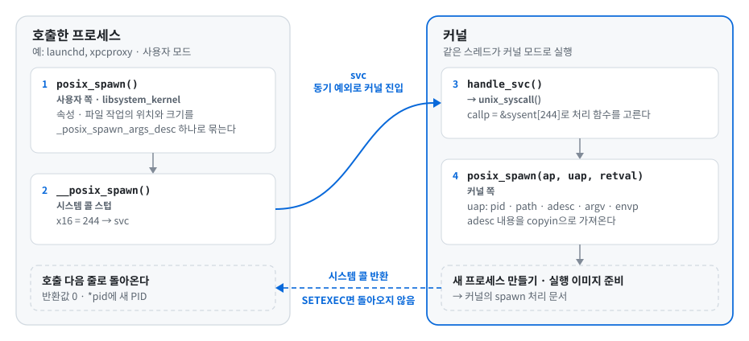

# posix_spawn

## 개요

실행 파일 경로와 실행 환경(인자, 환경 변수, 파일 작업, 실행 속성)을 한 번에 넘겨, 그 프로그램을 실행하는 프로세스를 만들어 달라고 커널에 요청하는 호출. 이 문서는 **무엇을 어떤 형태로 넘기고, 그 요청이 커널 쪽 함수에 도착하기까지**를 다룬다. 요청을 받은 커널이 프로세스를 만드는 과정은 [커널의 spawn 처리](posix_spawn-kernel.md)에 있다.

| 항목             | 내용                                                        |
| ---------------- | ----------------------------------------------------------- |
| 종류             | 시스템 콜을 쓰는 C API (`<spawn.h>`)                        |
| 같은 이름의 함수 | 둘. 사용자 쪽 래퍼(libsystem_kernel)와 커널 쪽 구현         |
| 시스템 콜 번호   | 244                                                         |
| 표준             | POSIX. `POSIX_SPAWN_SETEXEC`, 프로세스 유형 등은 Apple 확장 |

## 용어

### 시스템 콜

사용자 코드가 커널에 서비스를 요청하고 커널이 받아 처리하는 과정. 정해진 번호와 인자를 정해진 자리에 두고, 정해진 명령으로 커널에 들어가는 규약을 따른다. 이 과정에 관여하는 층은 다음과 같다.

| 층        | 여기서는                  | 하는 일                                                         |
| --------- | ------------------------- | --------------------------------------------------------------- |
| API       | 사용자 쪽 `posix_spawn()` | 개발자가 부르는 C 함수                                          |
| 스텁      | `__posix_spawn()`         | 번호와 인자를 정해진 자리에 두고 커널로 들어가는 몇 줄의 기계어 |
| CPU 명령  | `svc`                     | 사용자 모드에서 커널 모드로 들어간다                            |
| 분배 코드 | `unix_syscall()`          | 번호를 보고 처리 함수를 고른다                                  |
| 처리 함수 | 커널 쪽 `posix_spawn()`   | 요청을 실제로 처리한다                                          |

### 실행 속성 (`posix_spawnattr_t`)

새 프로세스를 어떻게 만들지 정하는 설정 묶음. 플래그(`POSIX_SPAWN_SETEXEC` 등), 프로세스 유형, 포트 설정 같은 값이 들어간다. 호출하기 전에 `posix_spawnattr_init()`으로 만들고, `posix_spawnattr_set…()` 함수들로 채운다.

### 파일 작업 목록 (`posix_spawn_file_actions_t`)

"새 프로그램이 시작하기 전에 이 번호에 이 파일을 열어 붙여라" 같은 지시를 순서대로 쌓아 두는 목록. `posix_spawn_file_actions_addopen()` 같은 함수로 지시를 추가하고, 실제 열기 · 연결은 커널이 목록을 적용할 때 일어난다.

### `posix_spawn`과 `posix_spawnp`

하는 일은 같고, 실행 파일을 찾는 방식만 다르다. `posix_spawn()`은 `path`를 경로로 그대로 쓰고, `posix_spawnp()`는 이름에 `/`가 없으면 환경 변수 `PATH`의 디렉터리들에서 찾는다.

### 동기 예외

방금 실행한 명령 때문에 CPU가 정해진 커널 진입 위치로 제어를 넘기는 것. `svc`가 대표적이다.

## 구조

<p align="center">
  
</p>

왼쪽은 호출한 프로세스(사용자 모드), 오른쪽은 같은 스레드가 커널 모드에서 실행하는 커널 코드다. 번호는 아래 수명주기의 번호와 같다. 점선 상자의 "새 프로세스 만들기 · 실행 이미지 준비"부터는 [커널의 spawn 처리](posix_spawn-kernel.md)에서 다룬다.

| 구성요소                        | 종류                      | 하는 일                                                               |
| ------------------------------- | ------------------------- | --------------------------------------------------------------------- |
| 사용자 쪽 `posix_spawn()`       | C 함수 (libsystem_kernel) | 실행 속성 · 파일 작업을 하나로 묶어 스텁을 부른다                     |
| `struct _posix_spawn_args_desc` | 구조체                    | 실행 속성 · 파일 작업 · 포트 작업이 어디 있고 얼마나 큰지를 담는 묶음 |
| `__posix_spawn()`               | 시스템 콜 스텁            | `x16`에 244를 넣고 `svc`를 실행한다                                   |
| `handle_svc()`                  | 커널 C 함수               | `svc`로 들어온 예외를 시스템 콜 처리로 보낸다                         |
| `unix_syscall()`                | 커널 C 함수               | 번호로 시스템 콜 표(`sysent`)에서 처리 함수를 고른다                  |
| `sysent`                        | 커널 배열                 | 시스템 콜 번호별 처리 함수 표                                         |
| 커널 쪽 `posix_spawn()`         | 커널 C 함수               | 요청을 받아 실행 준비 자료구조를 만들고 인자를 커널로 가져온다        |
| `struct posix_spawn_args`       | 커널 구조체               | 커널 쪽 함수가 받는 인자 묶음(`uap`)                                  |

## 상태

호출하는 쪽이 요청을 위해 만들어 두는 것들이다.

| 무엇            | 종류                              | 어디에                       | 언제 생기나                                          |
| --------------- | --------------------------------- | ---------------------------- | ---------------------------------------------------- |
| 실행 속성       | `posix_spawnattr_t` 객체          | 호출한 프로세스의 메모리     | `posix_spawnattr_init()` 후 `set…()`으로 채움        |
| 파일 작업 목록  | `posix_spawn_file_actions_t` 객체 | 호출한 프로세스의 메모리     | `posix_spawn_file_actions_init()` 후 `add…()`로 쌓음 |
| 인자 묶음       | `struct _posix_spawn_args_desc`   | 호출한 프로세스의 메모리     | 사용자 쪽 `posix_spawn()` 안 (수명주기 · 2)          |
| PID를 받을 자리 | `pid_t` 변수                      | 호출한 쪽이 정함 (보통 스택) | 호출 전에 마련, 커널이 성공 시 값을 씀               |

## 수명주기

호출 한 번은 준비 → 사용자 쪽 함수 → 스텁 → 커널 진입 → 커널 쪽 함수 → 반환 순으로 진행된다.

### 1. 준비: 실행 속성과 파일 작업 목록 만들기

호출하기 전에 실행 속성과 파일 작업 목록을 만들어 채운다. 예를 들어 "`SETEXEC` 옵션을 준다"는 건 실제로는 세 호출이다. 속성에서 플래그 정수를 읽고, `0x0040` 비트를 OR로 켜서 다시 저장한 뒤, 그 속성의 주소를 `posix_spawn`의 네 번째 인자로 넘긴다.

```c
short flags;
posix_spawnattr_getflags(&attrs, &flags);
flags |= POSIX_SPAWN_SETEXEC;              // 0x0040
posix_spawnattr_setflags(&attrs, flags);
posix_spawn(NULL, path, &fileActions, &attrs, argv, envp);
```

`SETEXEC`는 함수가 아니라, 함수에 넘기는 실행 속성 안의 비트 하나다. 변수 이름은 설명용이다.

### 2. 사용자 쪽 `posix_spawn()`

호출한 스레드가 사용자 모드에서 부른다. 실행 속성 · 파일 작업 · 포트 작업이 어디 있고 얼마나 큰지를 `struct _posix_spawn_args_desc` 하나에 정리한 뒤, 스텁을 부른다.

```c
__posix_spawn(pid, path, adp, argv, envp);
```

인자가 여섯에서 다섯으로 줄었다. `file_actions`와 `attrp`가 `adp` 하나로 묶였기 때문이다.

### 3. 스텁: `__posix_spawn()`

C 함수처럼 호출되지만 내용은 몇 줄의 기계어다. 인자 다섯은 ARM64 호출 규약대로 이미 `x0`~`x4` 레지스터에 들어 있다. 스텁은 `x16`에 시스템 콜 번호 **244**를 넣고 `svc`를 실행한다. `svc`에서 CPU가 동기 예외를 처리하며 커널 진입 위치로 제어를 넘긴다.

### 4. 커널 진입과 분배

같은 스레드가 이제 커널 모드에서 커널 코드를 실행한다.

1. 예외 처리 코드가 원인이 64비트 `svc`임을 보고 `handle_svc()`로 보낸다.
2. `handle_svc()`가 BSD 시스템 콜이면 `unix_syscall(state, thread, p)`를 부른다.
3. `unix_syscall()`이 저장된 레지스터에서 번호를 읽고 `callp = &sysent[syscode]`로 처리 함수를 고른다.
4. 244번 칸의 함수, 즉 커널 쪽 `posix_spawn()`을 부른다.

`svc`는 커널로 들어가는 **계기**이고, 244는 들어온 뒤 **어떤 처리 함수를 고를지** 정하는 값이다.

### 5. 커널 쪽 `posix_spawn()`

```c
int posix_spawn(proc_t ap, struct posix_spawn_args *uap, int32_t *retval);
```

사용자 쪽 `posix_spawn()`과 이름만 같은 다른 함수다.

| 인자     | 뜻                                                                        |
| -------- | ------------------------------------------------------------------------- |
| `ap`     | **요청한** 프로세스의 커널 관리 구조체(`proc`). 새 프로세스의 것이 아니다 |
| `uap`    | 이번 시스템 콜의 인자 묶음 구조체의 주소. 필드는 아래 표                  |
| `retval` | 시스템 콜의 결과를 돌려줄 자리. 새 PID를 쓰는 곳(`uap->pid`)과는 다르다   |

`uap`의 필드는 모두 **호출한 프로세스의** 사용자 공간 주소다.

| 필드    | 가리키는 것                         | 방향                             |
| ------- | ----------------------------------- | -------------------------------- |
| `pid`   | 호출자가 새 PID를 받아 둘 자리      | 커널이 **써 주는** 곳. 생략 가능 |
| `path`  | 실행 파일 경로 문자열               | 커널이 **읽어 오는** 곳          |
| `adesc` | 2에서 만든 `_posix_spawn_args_desc` | 읽어 오는 곳                     |
| `argv`  | 인자 문자열 주소들의 배열           | 읽어 오는 곳                     |
| `envp`  | `"이름=값"` 문자열 주소들의 배열    | 읽어 오는 곳                     |

진입 직후 실행 준비용 자료구조(`image_params` 등)를 마련하고, `adesc`의 내용을 `copyin`으로 사용자 공간에서 커널 메모리로 복사한다. 이 시점엔 아직 새 프로세스도 스레드도 없다. 이후는 [커널의 spawn 처리](posix_spawn-kernel.md)에서 이어진다.

### 6. 반환

성공하면 `0`을 반환하고, `pid`를 넘겼다면 그 자리에 새 PID가 들어 있다. 호출한 스레드는 다음 줄로 돌아온다. 반환값 `0`은 "프로세스를 만들고 실행 준비를 마쳤다"는 뜻이지, 새 프로그램이 어디까지 실행됐다는 뜻은 아니다. `SETEXEC`가 켜져 있으면 성공했을 때 돌아오지 않는다.

## 인터페이스

### 시그니처

```c
int posix_spawn(pid_t *pid, const char *path,
                const posix_spawn_file_actions_t *file_actions,
                const posix_spawnattr_t *attrp,
                char *const argv[], char *const envp[]);
```

| 인자           | 내용                                                                            |
| -------------- | ------------------------------------------------------------------------------- |
| `pid`          | 새 프로세스의 PID를 돌려받을 자리의 주소. 커널이 여기에 숫자를 써 준다          |
| `path`         | 실행할 파일의 경로                                                              |
| `file_actions` | 새 프로그램이 시작하기 전에 적용할 파일 작업 목록                               |
| `attrp`        | 실행 속성 (플래그, 프로세스 유형, 포트 설정 등)                                 |
| `argv`         | 인자 문자열 주소들의 배열. 마지막 칸은 `NULL`. `argv[0]`은 관례상 프로그램 이름 |
| `envp`         | `"이름=값"` 문자열 주소들의 배열. 마지막 칸은 `NULL`                            |

### 실행 속성의 플래그: `SETEXEC`

| 플래그                           | 동작                                                                                                                                                                     |
| -------------------------------- | ------------------------------------------------------------------------------------------------------------------------------------------------------------------------ |
| 없음 (기본)                      | 호출한 프로세스는 그대로 두고, 별도 PID를 가진 새 프로세스를 만들어 그 안에서 `path`를 실행한다                                                                          |
| `POSIX_SPAWN_SETEXEC` (`0x0040`) | 별도 PID의 새 프로세스를 만들지 않는다. 호출한 프로세스의 PID를 유지한 채 실행 이미지를 `path`의 프로그램으로 교체한다. 커널 주석은 이를 "옵션이 붙은 execve"로 설명한다 |

교체되는 건 프로세스의 메모리에 올라와 있던 실행 이미지다. 커널 안에서는 이때도 `proc` · `task` · `thread`를 새로 만들고 PID 자리만 이어받는다([커널의 spawn 처리](posix_spawn-kernel.md) 1번). 디스크의 원래 프로그램 파일은 그대로이고, PID와 미리 바꿔 둔 작업 디렉터리 같은 프로세스의 상태는 남는다. 예를 들어 [xpcproxy](xpcproxy.md)는 자기 프로세스 안에서 실행 환경을 준비한 뒤, `SETEXEC`로 같은 PID에서 앱으로 바뀐다.

### 실행 속성의 프로세스 유형

| 값      | 상수                                       |
| ------- | ------------------------------------------ |
| `0x100` | `POSIX_SPAWN_PROC_TYPE_APP_DEFAULT`        |
| `0x200` | `POSIX_SPAWN_PROC_TYPE_APP_NONUI`          |
| `0x300` | `POSIX_SPAWN_PROC_TYPE_DAEMON_STANDARD`    |
| `0x400` | `POSIX_SPAWN_PROC_TYPE_DAEMON_INTERACTIVE` |
| `0x500` | `POSIX_SPAWN_PROC_TYPE_DAEMON_BACKGROUND`  |
| `0x600` | `POSIX_SPAWN_PROC_TYPE_DAEMON_ADAPTIVE`    |
| `0x700` | `POSIX_SPAWN_PROC_TYPE_DRIVER`             |

분석에서 본 값과 맞춰 보면, [launchd](launchd.md)가 xpcproxy를 띄울 때 쓰는 `0x400`은 `DAEMON_INTERACTIVE`, 일반 앱의 `0x100`은 `APP_DEFAULT`다.

### 파일 작업의 종류

| 종류                 | 지시를 쌓는 함수                               |
| -------------------- | ---------------------------------------------- |
| 열기                 | `posix_spawn_file_actions_addopen`             |
| 닫기                 | `posix_spawn_file_actions_addclose`            |
| 복제                 | `posix_spawn_file_actions_adddup2`             |
| 상속                 | `posix_spawn_file_actions_addinherit_np`       |
| fileport 복제        | `posix_spawn_file_actions_add_fileportdup2_np` |
| 디렉터리 변경        | `posix_spawn_file_actions_addchdir_np`         |
| 디렉터리 변경 (fd로) | `posix_spawn_file_actions_addfchdir_np`        |

각 종류가 fd를 어떻게 바꾸는지는 [파일 디스크립터](file-descriptor.md)에 있다.

## 관련 문서

- 노드
  - [launchd](launchd.md), [xpcproxy](xpcproxy.md): 이 호출을 쓰는 쪽.
  - [커널의 spawn 처리](posix_spawn-kernel.md): 커널 쪽 `posix_spawn()`이 이어서 하는 일.
  - [파일 디스크립터](file-descriptor.md): 파일 작업 목록이 바꾸는 대상.
- 경로
  - [앱 실행: 터치 → AppDelegate.init()](../paths/app-launch.md)

## 참고 문헌

### 공개 소스

[xnu-12377.1.9](https://github.com/apple-oss-distributions/xnu/tree/xnu-12377.1.9) 기준.

- `libsyscall/wrappers/spawn/posix_spawn.c`: 사용자 쪽 `posix_spawn()` [L3014](https://github.com/apple-oss-distributions/xnu/blob/xnu-12377.1.9/libsyscall/wrappers/spawn/posix_spawn.c#L3014), `__posix_spawn` 호출 [L3104](https://github.com/apple-oss-distributions/xnu/blob/xnu-12377.1.9/libsyscall/wrappers/spawn/posix_spawn.c#L3104)
- `libsyscall/custom/SYS.h`: 스텁의 `x16` · `svc` [L452](https://github.com/apple-oss-distributions/xnu/blob/xnu-12377.1.9/libsyscall/custom/SYS.h#L452)
- `bsd/kern/syscalls.master`: 244번 [L352](https://github.com/apple-oss-distributions/xnu/blob/xnu-12377.1.9/bsd/kern/syscalls.master#L352)
- `bsd/sys/spawn.h`: `POSIX_SPAWN_SETEXEC` [L59](https://github.com/apple-oss-distributions/xnu/blob/xnu-12377.1.9/bsd/sys/spawn.h#L59)
- `bsd/sys/spawn_internal.h`: 프로세스 유형 [L362](https://github.com/apple-oss-distributions/xnu/blob/xnu-12377.1.9/bsd/sys/spawn_internal.h#L362), 파일 작업 종류 [L396](https://github.com/apple-oss-distributions/xnu/blob/xnu-12377.1.9/bsd/sys/spawn_internal.h#L396), `_posix_spawn_args_desc` [L484](https://github.com/apple-oss-distributions/xnu/blob/xnu-12377.1.9/bsd/sys/spawn_internal.h#L484)
- `osfmk/arm64/sleh.c`: 예외 분기 [L869](https://github.com/apple-oss-distributions/xnu/blob/xnu-12377.1.9/osfmk/arm64/sleh.c#L869), `handle_svc` [L2291](https://github.com/apple-oss-distributions/xnu/blob/xnu-12377.1.9/osfmk/arm64/sleh.c#L2291), `unix_syscall` 호출 [L2333](https://github.com/apple-oss-distributions/xnu/blob/xnu-12377.1.9/osfmk/arm64/sleh.c#L2333)
- `bsd/dev/arm/systemcalls.c`: `unix_syscall` [L90](https://github.com/apple-oss-distributions/xnu/blob/xnu-12377.1.9/bsd/dev/arm/systemcalls.c#L90), `sysent` 조회 [L113](https://github.com/apple-oss-distributions/xnu/blob/xnu-12377.1.9/bsd/dev/arm/systemcalls.c#L113)
- `bsd/kern/kern_exec.c`: 커널 쪽 `posix_spawn()` [L3711](https://github.com/apple-oss-distributions/xnu/blob/xnu-12377.1.9/bsd/kern/kern_exec.c#L3711), `adesc` copyin [L3790](https://github.com/apple-oss-distributions/xnu/blob/xnu-12377.1.9/bsd/kern/kern_exec.c#L3790), `SETEXEC` 주석 [L4040](https://github.com/apple-oss-distributions/xnu/blob/xnu-12377.1.9/bsd/kern/kern_exec.c#L4040), 기본 동작 [L4045](https://github.com/apple-oss-distributions/xnu/blob/xnu-12377.1.9/bsd/kern/kern_exec.c#L4045)

### 표준 문서

- [POSIX `posix_spawn`](https://pubs.opengroup.org/onlinepubs/9699919799/functions/posix_spawn.html): 인자의 의미, `posix_spawnp`의 `PATH` 검색

### 분석

- launchd가 xpcproxy를 띄울 때 `posix_spawnp(&childPID, …)`를 쓰고 프로세스 유형이 `0x400`이라는 것
- xpcproxy가 `SETEXEC`를 켜는 세 호출의 순서와 `posix_spawn(NULL, …)` 호출
- 일반 앱의 프로세스 유형 `0x100`
