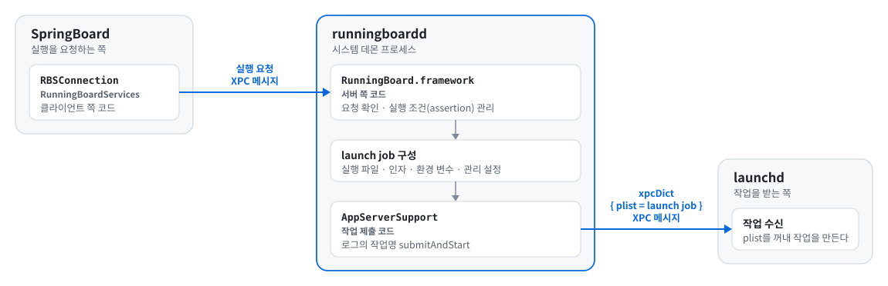

# runningboardd

## 개요

프로세스의 실행 상태와 실행 조건을 관리하는 시스템 데몬 프로세스. 앱 실행 요청을 받으면 "이 프로그램을 이런 설정으로 시작 · 관리해 달라"는 작업(launch job)을 만들어 launchd에 제출하고, 시작한 뒤에도 그 프로세스를 계속 실행해 둘지 멈출지를 관리한다.

| 항목             | 내용                                         |
| ---------------- | -------------------------------------------- |
| 종류             | 프로세스 (시스템 데몬)                       |
| 실행 영역        | 사용자 공간                                  |
| 요청을 보내는 쪽 | SpringBoard 등 (RunningBoardServices를 통해) |
| 작업을 넘기는 쪽 | launchd                                      |

## 용어

### 데몬

사용자와 직접 상호작용하지 않고 백그라운드에서 일하는 프로세스. 이름 끝의 `d`(runningboard**d**, backboard**d**, launch**d**)는 데몬이라는 관례다.

### RunningBoard라는 이름의 셋

| 이름                             | 정체                                                       |
| -------------------------------- | ---------------------------------------------------------- |
| `runningboardd`                  | 실행 상태를 관리하는 데몬 프로세스                         |
| `RunningBoard.framework`         | runningboardd가 쓰는 서버 쪽 코드 묶음                     |
| `RunningBoardServices.framework` | 요청하는 쪽(SpringBoard 등)이 쓰는 클라이언트 쪽 코드 묶음 |

### 실행 조건 (assertion)

프로세스를 어떤 상태로 둘지 정하는 실행 유지 조건. 예를 들어 "이 프로세스를 계속 실행해 둔다" 같은 조건이다. 클라이언트 쪽에서는 `RBSAssertion` 객체로 표현되고, 만들어서 획득하면 그 조건이 걸린다. 프로세스가 background, suspended, 종료 중 어느 상태에 있을지가 이 조건으로 정해진다.

### launch job

launchd에 맡길 실행 작업의 정의. "무엇을 어떤 설정으로 실행할지"를 담은 XPC 딕셔너리다.

### XPC와 XPC 딕셔너리

- **XPC**: Apple이 제공하는 IPC 방식 중 하나.
- **XPC 딕셔너리**: XPC로 주고받는 메시지의 형태. 키로 값을 찾는 딕셔너리이고, 값은 문자열 · 숫자 · 배열 · 딕셔너리 등이다. 값을 넣을 때는 `xpc_dictionary_set_uint64(...)` 같은 함수를 쓴다.

## 책임

- **실행 요청 받기**: SpringBoard 등이 보낸 실행 요청을 XPC 메시지로 받는다.
- **실행 상태 · 조건 관리**: 요청을 확인하고, 프로세스가 시작된 뒤에도 계속 실행할지 멈출지를 관리한다.
- **작업 구성**: 실행 파일 · 인자 · 환경 변수 · 관리 설정을 launch job 하나로 묶는다.
- **작업 제출**: launch job을 launchd에 보낸다.

runningboardd가 준비하는 건 **작업의 정의**까지다. 이걸 받은 launchd가 커널에 생성을 요청하고, `proc` · `task` · 첫 `thread` 같은 프로세스의 기본 틀은 [커널](posix_spawn-kernel.md)이 만든다.

## 구조

<p align="center">
  
</p>

| 구성요소                 | 종류                          | 하는 일                                                  |
| ------------------------ | ----------------------------- | -------------------------------------------------------- |
| `RBSConnection`          | 클래스 (RunningBoardServices) | 요청하는 프로세스 쪽에서 runningboardd와의 연결을 맡는다 |
| `RunningBoard.framework` | 프레임워크                    | 요청을 확인하고 실행 상태 · 조건을 관리한다              |
| `AppServerSupport`       | 프레임워크                    | 구성한 작업을 launchd에 제출한다                         |
| `RBSAssertion`           | 클래스 (RunningBoardServices) | 실행 유지 조건을 나타내는 객체                           |

## 상태

| 무엇                                    | 종류                        | 어디에                                | 언제 생기나                   |
| --------------------------------------- | --------------------------- | ------------------------------------- | ----------------------------- |
| 관리 중인 프로세스들의 실행 상태 · 조건 | 내부 자료구조 (형태 미확인) | runningboardd 메모리                  | 프로세스를 관리하는 동안 계속 |
| launch job                              | XPC 딕셔너리                | runningboardd 메모리 → launchd로 보냄 | 실행 요청마다                 |

## 수명주기

실행 요청 하나는 받기 → 확인 → 작업 구성 → 제출 순으로 처리된다. 비공개 구현이고 실행 중에는 관찰하지 못해서 역할과 호출 흐름 수준으로 정리했다.

### 1. 실행 요청을 받는다

SpringBoard 안의 RunningBoardServices 코드가 보낸 XPC 메시지를 runningboardd가 받는다. 메시지에는 누가 요청했나, 어떤 앱인가, 어떤 실행 의도 · 조건인가가 들어 있다.

### 2. 요청을 확인한다

runningboardd의 스레드가 `RunningBoard.framework`의 실행 관리 코드를 실행해 상태와 조건을 확인한다. 이 프로세스에 대한 관리는 시작한 뒤에도 계속된다.

### 3. launch job을 구성한다

같은 스레드가 실행 파일 경로(`Program`), 인자 목록(`ProgramArguments`), 환경 변수, 앱 식별 정보를 담아 launch job을 만든다.

### 4. 작업을 제출한다

같은 스레드가 `AppServerSupport`의 코드로 작업을 제출한다. 로그에 나오는 작업명은 `submitAndStart`(작업을 제출하고 시작을 요청한다)인데, 이게 정확한 메서드 시그니처는 아니다.

### 5. launchd로 보낸다

iOS 17.0 재현 코드에서는 launch job을 XPC 딕셔너리에 담아 다음처럼 제출한다.

```c
_launch_job_routine(0x3e8, xpcDict, &result);
```

이 시점에는 아직 새 프로세스가 없다. 받은 뒤의 일은 [launchd](launchd.md)에 있다.

## 인터페이스

| 방향 | 상대           | 수단                              | 오가는 것                         |
| ---- | -------------- | --------------------------------- | --------------------------------- |
| 입력 | SpringBoard 등 | XPC 메시지 (RunningBoardServices) | 요청자, 대상 앱, 실행 의도 · 조건 |
| 출력 | launchd        | XPC 메시지                        | `xpcDict { plist = launch job }`  |

## 미해결 질문

- runningboardd가 실행 요청을 처음 받는 메서드와 검사 항목
- 앱 식별자로 실행 파일 경로를 찾는 과정
- iOS 26.1의 제출 함수와 바깥 메시지의 키

## 관련 문서

- 노드
  - [SpringBoard](springboard.md): 실행 요청을 보내는 쪽.
  - [launchd](launchd.md): launch job을 받는 쪽.
  - [커널의 spawn 처리](posix_spawn-kernel.md): 프로세스의 기본 틀이 실제로 만들어지는 곳.
- 경로
  - [앱 실행: 터치 → AppDelegate.init()](../paths/app-launch.md)
