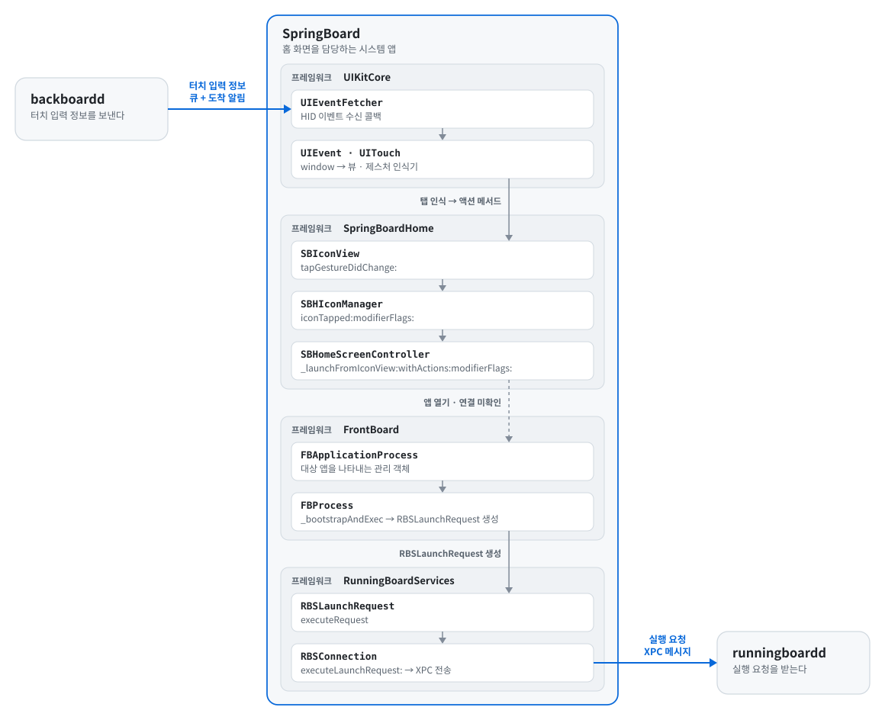

# SpringBoard

## 개요

홈 화면을 담당하는 시스템 앱 프로세스. 받은 터치 입력을 "어느 아이콘을 탭했나"로 해석하고, 그 아이콘에 연결된 앱을 열기 위한 실행 요청을 만들어 runningboardd로 보낸다.

| 항목      | 내용                                                                        |
| --------- | --------------------------------------------------------------------------- |
| 종류      | 프로세스 (시스템 앱)                                                        |
| 실행 영역 | 사용자 공간                                                                 |
| 실행 시점 | 홈 화면이 떠 있는 동안 계속 실행 중. 사용자가 아이콘을 누를 때 이미 떠 있다 |
| 받는 것   | backboardd가 보낸 터치 입력 정보                                            |
| 보내는 것 | runningboardd로 앱 실행 요청                                                |

## 용어

### 제스처 인식기

터치의 단계(접촉 시작 · 이동 · 끝)를 지켜보다가 특정 동작인지 판단하는 객체. 미리 target(객체)과 action(메서드)을 등록해 두면, 그 동작으로 인식했을 때 그 객체의 그 메서드를 부른다. 탭은 탭 인식기가 접촉 시작과 끝을 보고 내린 판단이다.

### 관리 객체 (`FBApplicationProcess`)

FrontBoard가 앱 하나를 다루기 위해 만드는 객체. 그 앱의 시작 작업 진행 상황과 실패 · 오류를 기록한다.

### 실행 의도

실행 요청에 담기는 "어떤 상태로 시작할지"에 대한 값. 아이콘을 눌러 앱을 열 때는 `foreground-interactive`(앞에 띄워 사용자와 상호작용)다. 대상 앱이 누구인지는 bundle identifier로 나타낸다.

## 책임

- **홈 화면 관리**: 아이콘을 비롯한 홈 화면 요소를 그리고 관리한다. 아이콘은 대상 앱이 아니라 SpringBoard가 그리는 화면 요소라서, 탭을 받고 해석하는 것도 SpringBoard다.
- **터치 입력 받기**: backboardd가 보낸 입력 정보를 UIKitCore로 받아 뷰와 제스처 인식기로 보낸다.
- **탭 해석**: 탭을 인식하고, 실행할 아이콘이면 그 아이콘에 연결된 앱을 연다.
- **앱 시작 조정**: FrontBoard로 대상 앱의 관리 객체를 다루며 시작 작업을 진행한다.
- **실행 요청 전송**: RunningBoardServices로 runningboardd에 실행 요청을 보낸다.

## 구조

<p align="center">
  
</p>

큰 상자가 SpringBoard, 안의 네 칸은 SpringBoard에서 일하는 프레임워크다. 파란 화살표는 다른 프로세스와 주고받는 것이고, 점선은 코드 경로를 아직 찾지 못한 연결이다.

| 프레임워크           | 하는 일                                                                        | 주요 클래스                                              |
| -------------------- | ------------------------------------------------------------------------------ | -------------------------------------------------------- |
| UIKitCore            | UIKit의 주요 구현. 터치 이벤트를 받아 뷰와 제스처 인식기로 보낸다              | `UIEventFetcher`, `UIEvent`, `UITouch`                   |
| SpringBoardHome      | 홈 화면 기능을 구현하는 비공개 코드. 아이콘 탭을 해석한다                      | `SBIconView`, `SBHIconManager`, `SBHomeScreenController` |
| FrontBoard           | 앱 · Scene의 생명주기와 화면 상태 전환. 대상 앱을 나타내는 관리 객체를 다룬다  | `FBApplicationProcess`, `FBProcess`                      |
| RunningBoardServices | RunningBoard 서비스에 요청을 보내는 클라이언트 코드. XPC 전송 코드가 여기 있다 | `RBSLaunchRequest`, `RBSConnection`                      |

## 상태

| 무엇                                                   | 종류             | 어디에                               | 언제 생기나                                 |
| ------------------------------------------------------ | ---------------- | ------------------------------------ | ------------------------------------------- |
| HID 이벤트 콜백 등록 (`_UIEventFetcherHandleHIDEvent`) | 함수 주소        | `UIEventFetcher` 스레드의 run loop   | `UIEventFetcher`가 준비될 때 (수명주기 · 1) |
| 아이콘 뷰마다 탭 인식기 (`SBIconTapGestureRecognizer`) | Objective-C 객체 | SpringBoard 메모리, 아이콘 뷰에 붙음 | 아이콘 뷰가 만들어질 때 (수명주기 · 2)      |
| 아이콘 모델과 앱 정보 (`SBIcon`, `SBApplicationIcon`)  | Objective-C 객체 | SpringBoard 메모리                   | 홈 화면을 구성할 때 (만드는 주체는 미확인)  |
| 대상 앱의 관리 객체 (`FBApplicationProcess`)           | Objective-C 객체 | SpringBoard 메모리                   | 앱을 시작할 때 (수명주기 · 4)               |

## 수명주기

아이콘 탭 하나가 실행 요청이 되기까지의 흐름이다. 비공개 구현이라 역할과 호출 흐름 수준으로 정리했다.

### 1. 터치 입력을 받는다 · UIKitCore

1. 미리: `UIEventFetcher`가 자기 스레드(`threadMain`)에서 `BKSHIDEventRegisterEventCallbackOnRunLoop(...)`를 호출해, HID 이벤트가 오면 실행할 콜백 `_UIEventFetcherHandleHIDEvent`를 등록해 둔다.
2. backboardd가 보낸 입력 정보가 도착하면 그 콜백이 실행되고, `UIEventFetcher`의 `_receiveHIDEventInternal:`로 넘어가 필터와 큐 처리를 거친다.
3. UIKitCore가 `UIEvent` · `UITouch`로 window에 전달하고, 어느 뷰에 해당하는지 판단해 뷰와 제스처 인식기가 처리하게 한다. SpringBoard 자신의 `sendEvent:`가 추가 처리를 한 뒤 `super`를 부른다.

### 2. 탭을 인식한다 · SpringBoardHome

1. 미리: 아이콘 뷰가 만들어질 때 탭 인식기를 등록해 둔다.

   ```objc
   [[SBIconTapGestureRecognizer alloc] initWithTarget:self
                                               action:@selector(tapGestureDidChange:)];
   ```

   "탭 인식 상태가 바뀌면 이 아이콘 뷰(`self`)의 `tapGestureDidChange:`를 불러 달라"는 뜻이다.

2. 손가락이 닿았다 떨어지면 인식기가 탭을 인식하고, `SBIconView`의 `tapGestureDidChange:`가 불린다. 인식 완료 상태인지 확인한 뒤 같은 객체의 `_handleTapWithModifierFlags:`를 부른다.
3. 그 메서드가 아이콘 뷰의 `actionDelegate`에게 `iconTapped:modifierFlags:`를 보낸다.

### 3. 실행할 아이콘이면 열기로 넘긴다 · SpringBoardHome

1. `SBHIconManager`의 `iconTapped:modifierFlags:`가 실행 가능한 아이콘인지 분기한 뒤 `launchFromIconView:withActions:modifierFlags:`를 부른다.
2. 그 안의 block에서 delegate에게 `iconManager:launchIconForIconView:withActions:modifierFlags:`를 보내고, `SBHomeScreenController`가 이를 받아 `_launchFromIconView:withActions:modifierFlags:`를 실행한다.
3. 어느 앱인지는 FrontBoard가 처음부터 찾아내는 게 아니라, **아이콘에 이미 연결된 정보**에서 얻는다. 비공개 인터페이스를 선언한 외부 코드에 그 연결이 보인다.

| 연결                                | 의미                              |
| ----------------------------------- | --------------------------------- |
| `SBIconView`의 `icon`               | 아이콘 뷰가 표시하는 아이콘 모델  |
| `SBApplicationIcon`의 `application` | 앱 아이콘이 가리키는 앱 정보 객체 |
| `SBIcon`의 `applicationBundleID`    | 아이콘의 bundle identifier        |

### 4. 앱 프로세스 시작을 조정한다 · FrontBoard

1. 대상 앱을 나타내는 관리 객체 `FBApplicationProcess`가 SpringBoard 메모리 안에 있다. 이 객체에 대응해 시작 작업이 진행되고, 실패 · 오류도 이 객체에 기록된다(로그: `Bootstrapping app with intent foreground-interactive`).
2. FrontBoard의 `FBProcess`가 `_bootstrapAndExec` 메서드에서 `RBSLaunchRequest` 객체를 만들고, 그 객체에 `executeRequest` 메시지를 보낸다.

공개 예제에서 FrontBoard를 쓰는 모양은 이렇다. Apple SpringBoard의 소스가 아니라, FrontBoard를 호출하는 외부 개발자의 코드다.

| 호출                                                           | 하는 일                                                                                      |
| -------------------------------------------------------------- | -------------------------------------------------------------------------------------------- |
| `RBSProcessIdentity identityForEmbeddedApplicationIdentifier:` | 앱 식별자로 실행 대상의 신원 객체를 만든다                                                   |
| `FBProcessManager launchProcessWithContext:`                   | 대상과 실행 조건을 묶은 context를 받아 시작을 요청한다. 반환은 PID가 아니라 실행 문맥 객체다 |
| `FBApplicationProcessLaunchTransaction begin`                  | 시작 작업을 개시한다. transaction은 시작 작업의 진행을 묶어 다루는 객체다                    |

### 5. runningboardd로 보낸다 · RunningBoardServices

1. `RBSLaunchRequest`의 `executeRequest`가 `RBSConnection`의 `executeLaunchRequest:`를 부른다.
2. `executeLaunchRequest:`는 `messageForMethod:varguments:`로 메시지를 만들고, 자기 `_connection`으로 연결을 얻고, 메시지에 `sendToConnection:error:`를 보낸다. 그 안에서 `xpc_connection_send_message` 또는 `xpc_connection_send_message_with_reply_sync`로 갈라진다.
3. 이 메시지에 누가 요청했나, 어떤 앱인가, 어떤 실행 의도 · 조건(`foreground-interactive`)인가가 담겨 runningboardd로 간다. 이후는 [runningboardd](runningboardd.md)에 있다.

## 인터페이스

| 방향 | 상대          | 수단                              | 오가는 것                                     |
| ---- | ------------- | --------------------------------- | --------------------------------------------- |
| 입력 | backboardd    | HID 이벤트 연결 (큐 + 도착 알림)  | 터치 입력 정보 (접촉 위치 · 단계 · 시각)      |
| 출력 | runningboardd | XPC 메시지 (RunningBoardServices) | 실행 요청 (요청자, 대상 앱, 실행 의도 · 조건) |

### 정보의 의미가 바뀌는 곳

SpringBoard가 받는 것과 내보내는 것은 수준이 다른 정보다.

| 단계        | 정보                                       | 누가 의미를 만드나                                      |
| ----------- | ------------------------------------------ | ------------------------------------------------------- |
| 받는 것     | 접촉 위치 · 단계 · 시각                    | backboardd가 전달                                       |
| 중간        | "이 아이콘을 탭했다"                       | UIKitCore의 제스처 인식 + SpringBoardHome의 아이콘 코드 |
| 내보내는 것 | "이 앱을 이런 의도 · 조건으로 시작해 달라" | FrontBoard + RunningBoardServices                       |

좌표에는 "실행하라"는 뜻이 없다. 화면 요소와 연결해 해석하는 코드가 의미를 만든다.

## 버전 차이

| 내용                                          | 근거의 버전                         |
| --------------------------------------------- | ----------------------------------- |
| 클래스 · 메서드와 호출 경로                   | iOS 26.1 시뮬레이터(23B86) 바이너리 |
| `FBApplicationProcess`의 시작 로그, 실행 의도 | iOS 18 실기기 로그 (실행 실패 사례) |

## 미해결 질문

- digitizer 입력이 `UIEvent` · `UITouch`로 바뀌는 정확한 경로
- 아이콘의 `icon` · `application` · `applicationBundleID` 중 현재 탭 처리가 실제로 쓰는 것
- 홈 화면 코드에서 FrontBoard로 넘어가는 메서드와 인자

## 관련 문서

- 노드
  - [backboardd](backboardd.md): 터치 입력 정보를 보내는 쪽.
  - [runningboardd](runningboardd.md): 실행 요청을 받는 쪽.
- 경로
  - [앱 실행: 터치 → AppDelegate.init()](../paths/app-launch.md)

## 참고 문헌

### 바이너리 분석

iOS 26.1 시뮬레이터(23B86)의 SpringBoard와 프레임워크 바이너리를 정적으로 분석했다.

- 수명주기 1~3의 클래스 · 메서드와 호출 순서, 탭 인식기 등록 코드
- 수명주기 4의 `FBProcess _bootstrapAndExec` → `RBSLaunchRequest executeRequest` 코드 경로
- 수명주기 5의 `RBSConnection` 메시지 구성과 XPC 전송 분기

### 외부 자료

- [Apple 개발자 포럼 thread 764858](https://developer.apple.com/forums/thread/764858) (iOS 18 기기 로그): `FBApplicationProcess`의 시작 로그, `foreground-interactive`
- [Lizynz/FolderX launcher.xm](https://github.com/Lizynz/FolderX/blob/main/launcher.xm): `SBIconView` · `SBApplicationIcon` · `SBIcon`의 비공개 인터페이스 선언
- [khanhduytran0/FrontBoardAppLauncher](https://github.com/khanhduytran0/FrontBoardAppLauncher): FrontBoard를 호출하는 공개 예제
