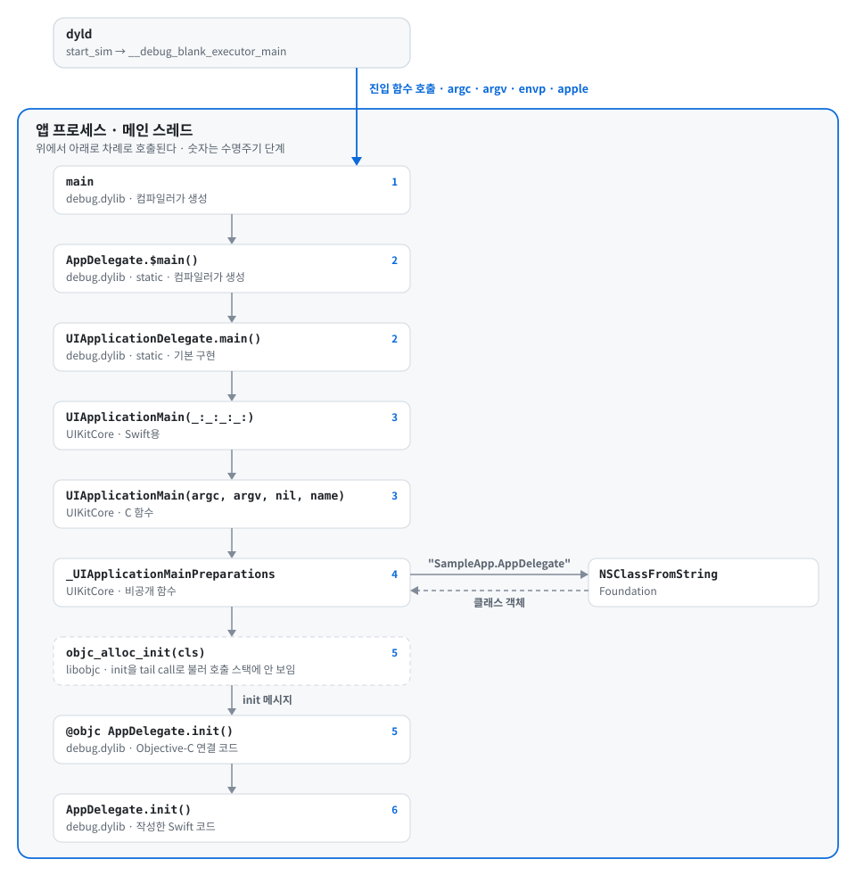

# UIApplicationMain

## 개요

UIKit 앱을 시작시키는 함수. 델리게이트 클래스의 이름을 받아 그 인스턴스를 만들고, 앱이 끝날 때까지 메인 run loop를 돈다. 이 문서는 dyld가 앱의 진입 함수를 부른 뒤, `@main`이 붙은 `AppDelegate`에서 출발해 이 함수가 `AppDelegate.init()`을 실행하기까지를 다룬다.

| 항목            | 내용                                                                            |
| --------------- | ------------------------------------------------------------------------------- |
| 종류            | UIKitCore의 C 함수 (Swift용 함수를 거쳐 들어온다)                               |
| 부르는 쪽       | `@main` 타입의 `static main()`, 즉 `UIApplicationDelegate`의 기본 `main()` 구현 |
| 실행하는 스레드 | 앱의 메인 스레드                                                                |
| 반환            | 하지 않는다. 앱이 끝날 때까지 메인 run loop를 돈다                              |

## 용어

### `@main`

Swift의 속성. 붙은 타입의 `static main()`을 프로그램 진입점으로 지정한다. 컴파일러는 이 지정을 바탕으로 진입 함수 `main`과 그 타입의 `$main()`을 만든다.

### static 메서드

인스턴스가 아니라 타입에 대해 부르는 메서드. 인스턴스가 아직 없어도 실행할 수 있어서, 프로그램의 진입점이 될 수 있다.

### 델리게이트 클래스 이름

`UIApplicationMain`에 넘기는, 델리게이트로 쓸 클래스의 이름 문자열. Swift 클래스는 `"모듈 이름.타입 이름"` 형태이고, 여기서는 `"SampleApp.AppDelegate"`다.

### 클래스 객체

Objective-C 런타임에서 클래스 자체를 나타내는 객체. `NSClassFromString`은 클래스 이름 문자열로 이 객체를 찾아 돌려주고, 이 객체에 `alloc`과 `init`을 보내 인스턴스를 만든다.

### `@objc` 연결 코드

Swift 메서드를 Objective-C 런타임에서 부를 수 있게 컴파일러가 만드는 짧은 코드(thunk). Objective-C 쪽에서 보낸 `init` 메시지가 이 코드를 거쳐 Swift의 `init()`으로 이어진다.

### tail call

함수의 마지막 동작이 다른 함수 호출일 때, 자기 스택 프레임을 남기지 않고 그 함수로 넘어가는 호출. tail call을 한 함수는 그 뒤의 호출 스택에 나타나지 않는다.

## 책임

- **델리게이트 클래스 찾기**: 받은 클래스 이름 문자열로 클래스 객체를 찾는다.
- **델리게이트 인스턴스 만들기**: 그 클래스로 인스턴스를 만들고 `init`을 실행한다.
- **application 객체 만들기**: `principalClassName`이 `nil`이면 기본 `UIApplication`으로 만든다.
- **메인 run loop 돌리기**: 이벤트를 받아 처리하며 앱이 끝날 때까지 반환하지 않는다. `didFinishLaunching` 이후는 이 문서의 범위 밖이다.

## 구조

<p align="center">
  
</p>

위에서 아래로 차례로 호출되는 함수들이다. 상자 아래 줄은 그 코드가 들어 있는 이미지(앱의 debug.dylib, UIKitCore, libobjc, Foundation)이고, 오른쪽 숫자는 아래 수명주기의 단계다. 점선 상자(`objc_alloc_init`)는 `init`을 tail call로 부르기 때문에 실제 호출 스택에는 나타나지 않는다.

| 구성요소                         | 종류                          | 하는 일                                                      |
| -------------------------------- | ----------------------------- | ------------------------------------------------------------ |
| `main`                           | C 진입 함수 (컴파일러 생성)   | dyld가 부르는 앱의 진입 함수. `AppDelegate.$main()`을 부른다 |
| `AppDelegate.$main()`            | static 메서드 (컴파일러 생성) | `@main` 타입의 `static main()`을 부른다                      |
| `UIApplicationDelegate.main()`   | static 메서드 (기본 구현)     | `UIApplicationMain(...)`을 부른다                            |
| `UIApplicationMain`              | UIKitCore C 함수              | 델리게이트와 application 객체를 만들고 run loop를 돈다       |
| `_UIApplicationMainPreparations` | UIKitCore 비공개 함수         | 클래스를 찾고 인스턴스를 만든다                              |
| `NSClassFromString`              | Foundation C 함수             | 클래스 이름 문자열로 클래스 객체를 찾는다                    |
| `objc_alloc_init`                | libobjc C 함수                | `[[cls alloc] init]`을 한 번에 한다                          |

## 상태

| 무엇                   | 종류                                     | 어디에                                     | 언제 생기나                                |
| ---------------------- | ---------------------------------------- | ------------------------------------------ | ------------------------------------------ |
| 델리게이트 클래스 이름 | `NSString`                               | `UIApplicationMain`의 인자                 | 수명주기 · 2에서 기본 구현이 만들어 넘긴다 |
| 델리게이트 클래스      | 클래스 객체                              | `_UIApplicationMainPreparations`의 지역 값 | 수명주기 · 4                               |
| `AppDelegate` 인스턴스 | Swift 클래스 인스턴스 (Objective-C 객체) | 힙, 이후 UIKit이 델리게이트로 보관         | 수명주기 · 5                               |
| application 객체       | `UIApplication`                          | 힙                                         | 생성 시점은 미확인                         |

## 수명주기

dyld가 `main`을 부르는 데서 시작해 `AppDelegate.init()`이 실행되기까지다. 실제 호출 순서와 값은 예제 앱 `SampleApp`을 LLDB로 멈춰 확인했다.

### 호출 스택

`AppDelegate.init()` 안의 `super.init()` 직전에서 멈췄을 때의 호출 스택이다. 위가 먼저 실행된 것이다.

```text
dyld          start
dyld_sim      start_sim
SampleApp     main                                  (debug.dylib)
SampleApp     static AppDelegate.$main()            (컴파일러 생성)
SampleApp     static UIApplicationDelegate.main()   (기본 static 구현)
UIKitCore     UIApplicationMain(_:_:_:_:)           (Swift용)
UIKitCore     UIApplicationMain                     (C 함수)
UIKitCore     _UIApplicationMainPreparations
SampleApp     @objc AppDelegate.init()              (Objective-C 연결 코드)
SampleApp     AppDelegate.init()                    (작성한 Swift 코드)
```

`__debug_blank_executor_main`은 debug.dylib의 `main`으로 실행을 넘긴 뒤 스택에 남지 않았고, `objc_alloc_init`은 `init`을 tail call로 불러서 보이지 않는다(5).

### 1. `main`

dyld의 `start_sim`이 `__debug_blank_executor_main`을 거쳐 메인 스레드에서 부른다([dyld](dyld.md) 4). `@main`을 쓰면 직접 작성하지 않고 컴파일러가 만든다. 인자 `argc`, `argv`, `envp`, `apple`은 커널이 스택에 쌓은 것을 dyld가 그대로 넘긴 것이다. `AppDelegate.$main()`을 부른다.

### 2. `AppDelegate.$main()` → `UIApplicationDelegate.main()`

둘 다 타입에 대해 부르는 static 메서드라 `AppDelegate` 인스턴스가 없어도 실행된다.

| 메서드                         | 정체                                                                             |
| ------------------------------ | -------------------------------------------------------------------------------- |
| `AppDelegate.$main()`          | 컴파일러가 만든 진입 코드. 그 타입의 `static func main()`을 부른다               |
| `UIApplicationDelegate.main()` | `UIApplicationDelegate`가 제공하는 기본 `main()` 구현. 직접 작성하지 않아도 된다 |

`@main`은 이 시점에 `AppDelegate`를 시작점으로 지정했을 뿐이고, 인스턴스는 5에서 만들어진다. 기본 `main()` 구현은 UIKit이 제공하지만, 실측에서 그 기계어는 UIKitCore가 아니라 앱의 `SampleApp.debug.dylib` 안에 있었다. 이 구현이 `UIApplicationMain(...)`을 부른다.

### 3. `UIApplicationMain`

```objc
int UIApplicationMain(int argc, char *argv[],
                      NSString *principalClassName, NSString *delegateClassName);
```

Swift용 함수를 거쳐 UIKitCore의 C 함수로 들어온다. 실측한 인자 값은 다음과 같다.

| 인자                 | 값                        | 뜻                                                    |
| -------------------- | ------------------------- | ----------------------------------------------------- |
| `argc`, `argv`       | 실행 인자                 | 1에서 받은 그대로                                     |
| `principalClassName` | `nil`                     | application 객체에 기본 `UIApplication` 클래스를 쓴다 |
| `delegateClassName`  | `"SampleApp.AppDelegate"` | 델리게이트로 쓸 클래스의 이름 문자열                  |

델리게이트는 객체가 아니라 **클래스 이름**으로 넘어간다. 객체는 UIKit이 만든다. 이어서 UIKitCore 안의 `_UIApplicationMainPreparations(...)`를 부른다.

### 4. 클래스 찾기: `NSClassFromString`

`_UIApplicationMainPreparations`가 받은 이름으로 `NSClassFromString(@"SampleApp.AppDelegate")`를 불러 클래스 객체를 얻는다(호출 지점의 기계어로 확인). 델리게이트로 쓸 클래스가 문자열에서 실제 클래스로 바뀐다.

### 5. 인스턴스 만들기: `objc_alloc_init`

같은 함수가 4에서 찾은 클래스로 `objc_alloc_init(cls)`를 부른다. libobjc의 이 함수는 메모리를 할당하고, 그 인스턴스에 `init` 메시지를 보낸다. 메시지는 `@objc AppDelegate.init()`(연결 코드)을 거쳐 Swift `AppDelegate.init()`으로 이어진다.

`objc_alloc_init`은 할당을 마친 뒤 `init` 메시지를 tail call로 보낸다. 그래서 `init`이 실행될 때 `objc_alloc_init`의 프레임은 이미 없고, 실측 호출 스택에서는 `_UIApplicationMainPreparations`가 `init`을 직접 부른 것처럼 보인다. 중간 단계는 기계어를 함께 봐서 확인했다.

### 6. `AppDelegate.init()`

직접 작성한 Swift 이니셜라이저(작성하지 않았으면 컴파일러가 만든 것)가 메인 스레드에서 실행된다. 실측에서 `self`는 방금 생성된 인스턴스였고, 멈춘 위치는 `super.init()` 직전이었다.

`init()`이 반환되면 UIKit이 이 인스턴스를 델리게이트로 쓴다. `application(_:didFinishLaunchingWithOptions:)`는 그 뒤에 따로 불리고, 첫 화면과 시작 절차는 아직 끝나지 않은 상태다.

## 인터페이스

| 방향 | 상대          | 수단                            | 오가는 것                       |
| ---- | ------------- | ------------------------------- | ------------------------------- |
| 입력 | dyld          | 함수 호출 (`main`)              | `argc`, `argv`, `envp`, `apple` |
| 출력 | Foundation    | 함수 호출 (`NSClassFromString`) | 클래스 이름 → 클래스 객체       |
| 출력 | libobjc       | 함수 호출 (`objc_alloc_init`)   | 클래스 → 인스턴스               |
| 출력 | `AppDelegate` | `init` 메시지                   | 새 인스턴스                     |

## 미해결 질문

- `UIApplication` 객체와 델리게이트 중 무엇이 먼저 만들어지는지. 문서는 application 객체를 만들고 델리게이트를 만드는 순서로 설명하고 있긴 하다.

## 관련 문서

- 노드
  - [dyld](dyld.md): `main`을 부르는 쪽.
- 경로
  - [앱 실행: 터치 → AppDelegate.init()](../paths/app-launch.md)

## 참고 문헌

### LLDB 실측

iOS 26.1 시뮬레이터, Xcode 26.1.1, 예제 앱 `SampleApp` 디버그 빌드.

- `AppDelegate.init()` 안 `super.init()` 직전의 호출 스택
- `UIApplicationMain`의 인자 값 (`principalClassName = nil`, `delegateClassName = "SampleApp.AppDelegate"`)
- 기본 `main()` 구현의 기계어가 debug.dylib 안에 있다는 것
- `_UIApplicationMainPreparations`의 `NSClassFromString` · `objc_alloc_init` 호출 (기계어)

### 문서

- [SE-0281 `@main`](https://github.com/swiftlang/swift-evolution/blob/main/proposals/0281-main-attribute.md): `@main` 타입의 `static main()`이 진입점이 된다는 규칙. `$main`이라는 이름은 다루지 않는다
- [UIApplicationDelegate.main()](<https://developer.apple.com/documentation/uikit/uiapplicationdelegate/main()>): 기본 `main()` 구현
- [UIApplicationMain(_:_:_:_:)](<https://developer.apple.com/documentation/uikit/uiapplicationmain(_:_:_:_:)-1yub7>): 함수의 역할과 인자, 반환하지 않는다는 것
- [About the app launch sequence](https://developer.apple.com/documentation/uikit/about-the-app-launch-sequence): 델리게이트 생성 뒤 `didFinishLaunching`이 불리는 순서
