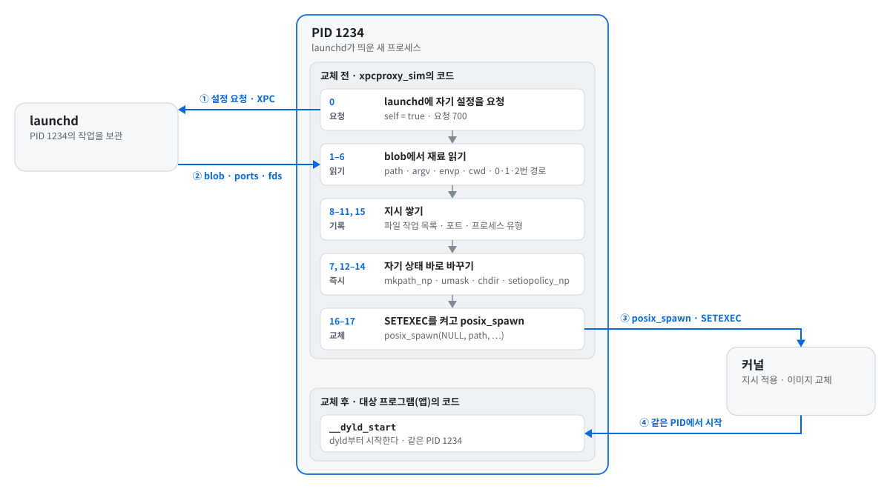

# xpcproxy

## 개요

launchd가 띄우는 보조 프로그램. 자기가 무엇으로 바뀌어야 하는지 launchd에 물어보고, 실행 환경을 준비한 뒤, 같은 PID에서 대상 프로그램(앱)으로 교체된다.

| 항목        | 내용                                                                                                                                        |
| ----------- | ------------------------------------------------------------------------------------------------------------------------------------------- |
| 종류        | 실행 파일이자, 잠깐 존재하는 프로세스. 교체가 끝나면 이 프로그램의 코드는 사라지고 PID만 남는다                                             |
| 위치        | 시뮬레이터: 런타임 루트 안의 `usr/libexec/xpcproxy_sim`. macOS에는 `xpcproxy(8)` 매뉴얼이 있다                                              |
| 띄우는 주체 | launchd. `posix_spawnp()`로 띄우고, 받는 인자는 `argv[0] = "xpcproxy_sim"`, `argv[1] = <작업의 Label>` 둘뿐이다 ([launchd](launchd.md) 4~5) |
| 끝          | `POSIX_SPAWN_SETEXEC`로 같은 PID에서 대상 프로그램으로 교체                                                                                 |

## 용어

### proxy

대리자. 여기서는 "XPC 서비스의 시작 준비를 대신 맡는 프로그램"이라는 뜻으로 풀 수 있다. 새 앱이 될 프로세스에서 처음 실행되는 프로그램의 이름이다.

### blob

Binary Large Object의 줄임말로, 형식이 정해진 바이트 덩어리를 말한다. 여기서는 launchd 응답 딕셔너리의 `"blob"` 키에 담긴 값으로, 실행 경로 · 인자 · 환경 변수 · 작업 디렉터리 · 입출력 경로 등을 정해진 형식으로 묶은 것이다. launchd가 보관하던 작업 정보로 다시 구성해 보낸다.

### 실행 이미지

프로세스 메모리에 올라와 실행 중인 프로그램의 코드와 데이터. `SETEXEC`로 교체되는 건 이것이고, 디스크의 xpcproxy 파일은 그대로 있다.

### 작업 디렉터리

프로세스가 **상대 경로**로 파일을 열 때 커널이 찾기 시작하는 디렉터리. 커널이 프로세스마다 기억하고(`fd_cdir`), `chdir()`로 바꾼다. 절대 경로는 `/`에서부터 찾는다.

### 파일 작업 목록과 실행 속성

`posix_spawn`에 넘길 지시와 설정의 묶음. 파일 작업 목록에는 "이 번호에 이 대상을 연결하라" 같은 지시가, 실행 속성에는 플래그 · 포트 · 프로세스 유형이 담긴다. 지시는 쌓아 두기만 하고, 실제 적용은 커널이 교체할 때 한다. 자세한 것은 [posix_spawn](posix_spawn.md).

## 책임

- **설정 요청**: 자신을 띄운 launchd에 "내가 무엇으로 바뀌어야 하는지"를 묻는다.
- **실행 재료 만들기**: 응답에서 실행 경로 · `argv` · `envp`를 꺼낸다.
- **지시 기록**: 0 · 1 · 2번 연결, 이미 열린 대상, 포트, 프로세스 유형을 파일 작업 목록과 실행 속성에 쌓는다.
- **자기 상태 설정**: 파일 생성 마스크, 작업 디렉터리, 디스크 입출력 정책을 직접 바꾼다.
- **교체**: `SETEXEC`를 켜고 `posix_spawn`을 호출해 대상 프로그램으로 바뀐다.

## 구조

<p align="center">
  
</p>

| 구성요소                                       | 종류                          | 하는 일                                                          |
| ---------------------------------------------- | ----------------------------- | ---------------------------------------------------------------- |
| `xpc_dictionary_get_data`                      | libxpc C 함수                 | 응답 딕셔너리에서 `blob`의 위치와 길이를 얻는다                  |
| `mkpath_np`                                    | C 함수                        | 경로의 폴더가 없으면 만든다                                      |
| `posix_spawn_file_actions_addopen`             | C 함수                        | 경로를 열어 번호에 붙이는 지시를 쌓는다                          |
| `posix_spawn_file_actions_add_fileportdup2_np` | C 함수                        | 이미 열린 대상을 번호에 붙이는 지시를 쌓는다                     |
| `xpc_mach_send_get_right`                      | libxpc C 함수                 | `ports` 항목에서 포트로 보낼 권한을 얻는다                       |
| `umask` · `chdir` · `setiopolicy_np`           | 시스템 콜                     | 이 프로세스의 마스크 · 작업 디렉터리 · 입출력 정책을 바로 바꾼다 |
| `posix_spawnattr_setflags`                     | C 함수                        | 실행 속성에 `SETEXEC` 비트를 저장한다                            |
| `posix_spawn`                                  | C 함수 (시스템 콜을 쓰는 API) | 쌓은 재료로 교체를 요청한다                                      |

## 상태

| 무엇                    | 종류                                  | 어디에          | 언제 생기나            |
| ----------------------- | ------------------------------------- | --------------- | ---------------------- |
| launchd의 응답          | XPC 딕셔너리 (`blob`, `ports`, `fds`) | xpcproxy 메모리 | 수명주기 · 0의 응답    |
| `posix_spawn` 재료 다섯 | 아래 표                               | xpcproxy 메모리 | 수명주기 · 1~17에 걸쳐 |

| 재료             | 만들어지는 단계 | `posix_spawn`의 몇 번째 인자 |
| ---------------- | --------------- | ---------------------------- |
| 실행 경로 `path` | 2               | 2                            |
| 파일 작업 목록   | 8, 9, 11        | 3                            |
| 실행 속성        | 10, 15, 17      | 4                            |
| `argv`           | 3               | 5                            |
| `envp`           | 4               | 6                            |

## 수명주기

모든 순서와 동작은 `xpcproxy_sim` 바이너리 분석으로 얻은 것이다. 단계마다 성격이 다르다.

| 성격 | 뜻                                 | 단계     |
| ---- | ---------------------------------- | -------- |
| 요청 | launchd에 묻는다                   | 0        |
| 읽기 | 응답에서 값을 꺼낸다               | 1~6, 16  |
| 기록 | 나중에 커널이 적용할 지시를 쌓는다 | 8~11, 15 |
| 즉시 | 지금 이 프로세스에 바로 적용한다   | 7, 12~14 |
| 교체 | 대상 프로그램으로 바뀐다           | 17       |

전체로 보면 파일과 포트에 관한 것은 지시로 쌓아 커널에 맡기고, 프로세스 자신의 상태(마스크, 작업 디렉터리, 입출력 정책)는 직접 바꾼다.

### 0. 자기 설정을 요청한다 · 요청

시작하자마자 XPC 딕셔너리를 만들어 `self = true`를 넣고, 조건에 따라 `pre-exec = true`도 넣는다. 요청 번호 `0x2bc`(700)는 딕셔너리 밖의 별도 인자로 붙여 launchd에 보낸다. `self = true`는 "보내는 나 자신에 관한 요청"이라는 뜻이고, 자기 PID나 앱 경로는 적지 않는다. launchd는 발신자 정보(audit token)의 PID로 작업 객체를 찾아 응답한다([launchd](launchd.md) 7~8).

### 1. 응답에서 `blob`을 꺼낸다 · 읽기

`xpc_dictionary_get_data`에 응답 딕셔너리와 키 이름 `"blob"`을 넘겨, 데이터의 위치와 바이트 수를 받는다. 데이터가 없거나 정해진 최소 길이보다 짧으면 오류로 처리한다. 이어서 같은 응답에 `ports`와 `fds` 항목이 있는지 확인한다. 이후 단계의 설정값은 전부 이 바이트 덩어리에서 읽는다.

### 2. 실행 경로를 찾는다 · 읽기

`blob` 앞부분에는 "경로 문자열이 뒤쪽 데이터의 몇 번째 바이트에서 시작하는지"가 숫자로 들어 있다. 그 위치가 데이터 범위 안인지, 문자열이 범위 안에서 끝나는지 검사한 뒤, 문자열의 시작 주소를 저장한다. 이 주소가 `posix_spawn`의 `path`가 된다.

### 3. `argv`를 만든다 · 읽기

`blob` 안의 인자 문자열을 차례로 확인하고, 각 문자열의 첫 글자 주소를 배열 칸에 넣는다. 인자가 2개면 3칸을 만들고 마지막 칸에 `NULL`을 넣는다. 이 배열의 주소가 `posix_spawn`의 다섯 번째 인자가 되고, 앱은 이것을 `main`의 `argv`로 받는다.

이 `argv`는 launchd가 xpcproxy를 띄울 때 준 `["xpcproxy_sim", Label]`과는 별개로, 앱이 받을 인자다. 어떤 파일을 실행할지는 `path`가 정하고, `argv[0]`은 관례상 프로그램 이름이다. 추가 인자가 없으면 `argv[1]`이 곧 `NULL`이다.

### 4. `envp`를 만든다 · 읽기

`blob`에서 환경 변수의 개수와 문자열 위치를 읽어 `"이름=값"` 문자열의 시작 주소를 배열에 넣고, `XPC_FLAGS` 같은 실행용 환경 변수를 더한다. 각 항목에 `=` 앞의 이름이 있는지 확인하고, 같은 이름이 여러 번 나오면 처음 것만 남긴 뒤, 마지막 칸에 `NULL`을 넣는다. `posix_spawn`의 여섯 번째 인자가 된다. `envp[0]`은 그냥 첫 번째 환경 변수다.

### 5. 작업 디렉터리 값을 읽는다 · 읽기

`blob`에서 작업 디렉터리(`cwd`) 경로를 읽는다. 지정이 없으면 다음 단계의 경로 조합 기준으로 `/`를 쓴다. 이 단계에서는 값을 손에 쥘 뿐이고, 이 프로세스의 작업 디렉터리는 13에서 바뀐다. 먼저 읽는 이유는 6에서 표준 입출력 경로가 상대 경로일 때 이 값이 기준으로 필요하기 때문이다.

### 6. 0번에 연결할 파일의 경로를 정한다 · 읽기

`blob`에서 표준 입력 경로를 읽는다. `/`로 시작하는 절대 경로면 그대로 쓰고, 상대 경로면 `snprintf`에 `"%s/%s"` 형식으로 5의 `cwd`와 이어 붙인다. 경로가 생략돼 있으면 `/dev/null`을 쓴다. 결과는 경로 **문자열** 하나이고, 파일은 아직 열리지 않았다.

### 7. 그 경로의 상위 폴더를 준비한다 · 즉시

경로가 지정된 경우, `strrchr`로 마지막 `/`의 위치를 찾아 그 자리에 널 문자 `\0`을 써서 문자열을 폴더 부분에서 끊는다. 같은 시작 주소를 `mkpath_np()`에 넘기면 첫 `\0`까지만 읽으므로 폴더 경로만 본다. 폴더가 없으면 만든다. 호출이 끝나면 `\0`으로 바꿨던 자리에 `/`를 다시 쓴다. 문자열을 복사하지 않고 문자 하나를 잠깐 바꿨다가 되돌리는 방식이다.

### 8. 0번 열기 지시를 등록한다 · 기록

`posix_spawn_file_actions_addopen()`에 네 가지를 넘긴다: 번호 `0`, 6에서 만든 경로 문자열의 주소, 여는 방식(읽기용, 없으면 만들기 `O_CREAT`), 만들 때 요청할 권한 `0666`. 파일 작업 목록에 "이 경로를 열어 0번에 연결하라"는 지시가 하나 추가되고, 실제로 열리는 건 17 이후 커널이 목록을 적용할 때다. 입력용인데 파일이 없으면 빈 파일을 만들도록 되어 있어서, 그 경우 앱이 읽으면 곧바로 입력 끝을 받는다.

### 9. 1번과 2번도 같은 방식으로 등록한다 · 기록

표준 출력과 표준 오류에 대해 6~8을 반복한다. 다른 점은 **쓰기용**으로 연다는 것이고, 일반 파일이면 기존 내용 뒤에 덧붙이도록 연다.

### 10. Mach 포트 설정을 실행 속성에 넣는다 · 기록

`blob`에서 설정할 포트의 개수를 읽고, 0개면 건너뛴다. 있으면 응답의 `ports` 배열에서 항목을 하나씩 꺼내 `xpc_mach_send_get_right()`로 그 포트로 보낼 권한을 얻고, `blob`에서 그 포트의 용도를 읽어 실행 속성에 기록한다. `blob`에는 포트의 개수와 용도가, 같은 응답의 `ports` 키에는 실제 포트 항목이 들어 있다.

### 11. 이미 열린 대상을 번호에 붙이는 지시를 등록한다 · 기록

응답의 `fds` 배열을 두 칸씩 한 쌍으로 읽는다. 첫 칸은 이미 열린 대상을 전달하는 `XPC_TYPE_FD` 값이고, 둘째 칸은 앱에서 그 대상을 가리킬 정수 번호다. 번호가 유효한지 확인하고, 첫 칸에서 열린 대상의 참조를 꺼내 `posix_spawn_file_actions_add_fileportdup2_np()`를 호출한다. 8~9와 같은 작업 목록에 지시가 쌓인다. `addopen`은 **앞으로 열 파일의 경로**를, 이 함수는 **이미 열린 대상의 참조**를 받는다는 점이 다르다([파일 디스크립터](file-descriptor.md)).

### 12. 파일 생성 마스크를 설정한다 · 즉시

`blob`에서 `umask`가 지정됐는지를 나타내는 비트를 확인하고, 지정돼 있으면 정수 값을 꺼내 `umask(mask)`를 호출한다. 이 프로세스의 마스크가 바로 바뀐다. 8의 열기 지시보다 뒤에 와도 되는 이유는, 파일이 실제로 만들어지는 게 17 이후이고 커널이 지시를 적용하면서 그때의 마스크를 요청 권한에서 빼기 때문이다.

### 13. 작업 디렉터리를 바꾼다 · 즉시

5에서 읽은 `cwd`가 지정돼 있으면 `chdir(path)`를 호출하고, 없으면 기존 값을 유지한다. 바뀌는 건 상대 경로를 해석하는 기준이고, 코드는 다음 줄부터 그대로 이어서 실행된다. 작업 디렉터리는 프로세스에 속한 값이라, 같은 PID에서 교체된 앱은 이 디렉터리에서 시작한다. 바꾸기 전의 값은 부모에게서 물려받은 것이고, 조회했을 때 `launchd_sim`과 앱 모두 `/`였다.

### 14. 디스크 입출력 정책을 설정한다 · 즉시

`blob`의 플래그 두 개를 확인해, 첫 번째가 켜져 있으면 `setiopolicy_np(0, 0, 3)`을, 두 번째가 켜져 있으면 `setiopolicy_np(0, 2, 3)`을 호출한다.

| 인자             | 값의 뜻                                                                                         |
| ---------------- | ----------------------------------------------------------------------------------------------- |
| 첫째 (종류)      | `0` (`IOPOL_TYPE_DISK`): 디스크 입출력                                                          |
| 둘째 (적용 범위) | `0` (`IOPOL_SCOPE_PROCESS`): 프로세스 전체, `2` (`IOPOL_SCOPE_DARWIN_BG`): 백그라운드 상태일 때 |
| 셋째 (정책)      | `3` (`IOPOL_THROTTLE`): 다른 입출력에 밀리도록 우선순위를 낮춤                                  |

두 플래그가 모두 꺼져 있으면 호출 없이 넘어간다.

### 15. 프로세스 유형을 확인한다 · 기록

`blob`에서 프로세스 유형을 읽어 `0x700`(드라이버)과 비교하고, 같을 때만 `posix_spawnattr_setprocesstype_np(&attrs, 0x700)`으로 실행 속성에 기록한다. 이어서 `pthread_setname_np()`로 지금 스레드의 이름을 설정한다. launchd는 최종 대상이 무엇이든 xpcproxy를 `0x400` 유형으로 띄우므로, 드라이버로 교체될 때만 최종 유형을 따로 지정해 준다. 일반 앱(`0x100`)은 아무것도 기록되지 않는다.

### 16. `posix_spawn`과 `posix_spawnp` 중 하나를 고른다 · 읽기

`inferred program` 플래그가 꺼져 있으면 `posix_spawn()`을, 켜져 있으면 `posix_spawnp()`를 고른다. 조회한 두 번의 앱 실행에서는 꺼져 있었다.

### 17. `SETEXEC`를 켜고 `posix_spawn`을 호출한다 · 교체

`posix_spawnattr_getflags`로 플래그를 읽고, `0x0040`(`POSIX_SPAWN_SETEXEC`) 비트를 OR로 켜서 `posix_spawnattr_setflags`로 저장한다. 그런 다음 다섯 재료를 넘긴다.

```c
posix_spawn(NULL, path, &fileActions, &attrs, argv, envp);
```

첫 인자가 `NULL`인 건, 같은 PID에서 바뀌므로 새 PID를 받아 둘 자리가 필요 없어서다. launchd가 `&childPID`를 넘긴 것과 대비된다.

성공하면 호출 다음 줄로 돌아오지 않고, 이 PID에서 실행되는 프로그램이 앱으로 바뀐다. 8~11에서 쌓은 지시는 이때 커널이 적용한다. launchd가 xpcproxy를 띄울 때 기록해 둔 PID가 그대로 앱의 PID가 되는 것도 이 때문이다. 커널 쪽 처리는 [커널의 spawn 처리](posix_spawn-kernel.md)에, 교체 후 처음 실행되는 코드는 [dyld](dyld.md)에 있다.

## 인터페이스

| 방향 | 상대    | 수단                                  | 오가는 것                                         |
| ---- | ------- | ------------------------------------- | ------------------------------------------------- |
| 입력 | launchd | 프로세스 실행 (`posix_spawnp`)        | `argv = ["xpcproxy_sim", Label]`                  |
| 출력 | launchd | XPC 메시지 (요청 700)                 | `self = true`, 조건에 따라 `pre-exec = true`      |
| 입력 | launchd | XPC 응답                              | `blob`, `ports`, `fds`                            |
| 출력 | 커널    | 시스템 콜 (`posix_spawn` + `SETEXEC`) | `path`, 파일 작업 목록, 실행 속성, `argv`, `envp` |

### `blob`에서 읽는 값

| 값                        | 읽는 단계 | 쓰이는 곳                           |
| ------------------------- | --------- | ----------------------------------- |
| 실행 경로                 | 2         | `posix_spawn`의 `path`              |
| 인자                      | 3         | `argv`                              |
| 환경 변수                 | 4         | `envp`                              |
| 작업 디렉터리             | 5         | 경로 조합(6, 9), `chdir()`(13)      |
| 0 · 1 · 2번 경로          | 6, 9      | 열기 지시(8, 9)                     |
| 포트 개수와 용도          | 10        | 실행 속성                           |
| `umask` 지정 여부와 값    | 12        | `umask()`                           |
| 입출력 정책 플래그        | 14        | `setiopolicy_np()`                  |
| 프로세스 유형             | 15        | 실행 속성 (드라이버일 때만)         |
| `inferred program` 플래그 | 16        | `posix_spawn` / `posix_spawnp` 선택 |

## 플랫폼 차이

|                | 시뮬레이터                               | 실기기        |
| -------------- | ---------------------------------------- | ------------- |
| 프로그램       | 런타임 루트의 `usr/libexec/xpcproxy_sim` | `xpcproxy`    |
| 이 문서의 근거 | 바이너리 분석                            | 확인하지 않음 |

## 관련 문서

- 노드
  - [launchd](launchd.md): xpcproxy를 띄우고, 설정을 응답으로 준다.
  - [posix_spawn](posix_spawn.md): 준비한 다섯 재료를 넘기는 호출. 파일 작업 목록과 실행 속성.
  - [파일 디스크립터](file-descriptor.md): 0 · 1 · 2번과 `fds` 배열이 다루는 대상.
  - [커널의 spawn 처리](posix_spawn-kernel.md): 17의 호출을 받아 이미지를 교체하는 쪽.
  - [dyld](dyld.md): 교체 후 이 PID에서 처음 실행되는 코드.
- 경로
  - [앱 실행: 터치 → AppDelegate.init()](../paths/app-launch.md)

## 참고 문헌

### 바이너리 분석

iOS 26.1 시뮬레이터 런타임의 `xpcproxy_sim`.

- 수명주기 0~17의 순서와 호출, 인자
- 앱 실행 두 번에서 `inferred program` 플래그가 꺼져 있었다는 것
- `launchd_sim`과 앱의 작업 디렉터리가 `/`였다는 것

### 공개 소스

[xnu-12377.1.9](https://github.com/apple-oss-distributions/xnu/tree/xnu-12377.1.9) 기준.

- `bsd/kern/kern_exec.c`: 파일 작업을 적용할 때의 마스크 계산 [L2994](https://github.com/apple-oss-distributions/xnu/blob/xnu-12377.1.9/bsd/kern/kern_exec.c#L2994)
- `bsd/sys/filedesc.h`: 작업 디렉터리 `fd_cdir` [L149](https://github.com/apple-oss-distributions/xnu/blob/xnu-12377.1.9/bsd/sys/filedesc.h#L149)
- `bsd/sys/resource.h`: `setiopolicy_np` 인자 값 [L568](https://github.com/apple-oss-distributions/xnu/blob/xnu-12377.1.9/bsd/sys/resource.h#L568)

### 문서

- `man 8 xpcproxy`: XPC 서비스의 실행 환경을 준비한 뒤 exec로 실행을 넘기는 프로그램이라는 설명
