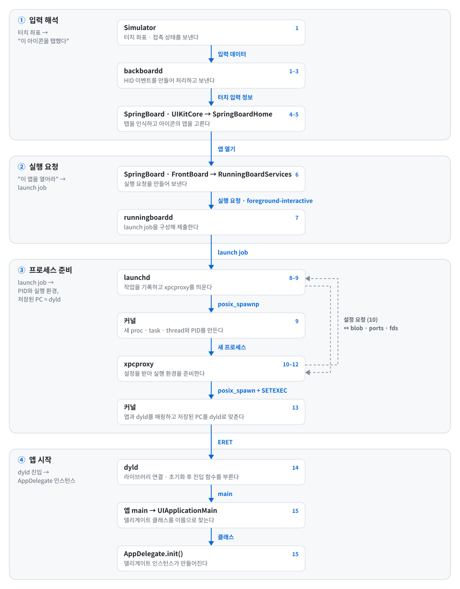

# 앱 실행: 터치 → AppDelegate.init()

## 개요

홈 화면의 아이콘을 누른 순간부터, 새 앱 프로세스에서 `AppDelegate.init()`이 실행되기까지의 흐름. 각 단계의 자세한 내용은 링크된 노드 문서에 있다.

| 항목      | 내용                                                                                                                      |
| --------- | ------------------------------------------------------------------------------------------------------------------------- |
| 환경      | iOS 26.1 시뮬레이터(빌드 23B86), Apple Silicon Mac, Xcode 26.1.1. 예제 UIKit 앱 `SampleApp`(디버그 빌드)                  |
| 기준 상황 | 홈 화면이 떠 있고, 대상 앱의 프로세스는 아직 없다. `@main AppDelegate`를 쓰는 UIKit 앱을 홈 화면 아이콘으로 새로 실행한다 |
| 범위      | 아이콘을 누른 순간부터 `AppDelegate.init()`까지. 화면이 그려지는 과정과 `didFinishLaunching` 이후는 다루지 않는다         |

## 전체 그림

  

## 단계

### ① 입력 해석

화면에 닿은 터치 좌표가 "이 아이콘을 탭했다"는 판단이 된다.

| 번호 | 어디서                                              | 하는 일                                                                                                                                                           | 다음으로 넘기는 것              |
| ---- | --------------------------------------------------- | ----------------------------------------------------------------------------------------------------------------------------------------------------------------- | ------------------------------- |
| 1    | Simulator → [backboardd](../nodes/backboardd.md)    | Mac의 Simulator가 터치 좌표와 접촉 상태를 보내고, backboardd 안에서 HID 이벤트가 만들어진다                                                                       | HID 이벤트                      |
| 2    | backboardd                                          | 등록해 둔 콜백 `_BKIOHIDEventCallback`이 불리고, `BKHIDSystem` → `BKHIDPrimaryEventProcessor` → `BKHIDDirectTouchEventProcessor`로 종류에 맞는 처리기에 전달된다  | 처리된 HID 이벤트               |
| 3    | backboardd → [SpringBoard](../nodes/springboard.md) | 클라이언트 연결로 입력 정보를 보낸다                                                                                                                              | 터치 입력 정보 (큐 + 도착 알림) |
| 4    | SpringBoard · UIKitCore                             | `UIEventFetcher`가 받아 `UIEvent` · `UITouch`로 window와 제스처 인식기에 보낸다                                                                                   | `UIEvent` · `UITouch`           |
| 5    | SpringBoard · SpringBoardHome                       | 탭 인식기가 `SBIconView`의 `tapGestureDidChange:`를 부르고, `SBHIconManager` → `SBHomeScreenController`로 넘어간다. 어느 앱인지는 아이콘에 연결된 정보로 정해진다 | "이 아이콘의 앱을 열어라"       |

### ② 실행 요청

"이 앱을 열어라"가 launchd에 맡길 실행 작업(launch job)이 된다.

| 번호 | 어디서                                          | 하는 일                                                                                                                                                          | 다음으로 넘기는 것                   |
| ---- | ----------------------------------------------- | ---------------------------------------------------------------------------------------------------------------------------------------------------------------- | ------------------------------------ |
| 6    | SpringBoard · FrontBoard → RunningBoardServices | `FBProcess`의 `_bootstrapAndExec`가 `RBSLaunchRequest`를 만들어 `executeRequest`를 보내고, `RBSConnection`이 [runningboardd](../nodes/runningboardd.md)로 보낸다 | 실행 요청 (`foreground-interactive`) |
| 7    | runningboardd                                   | 실행 조건을 확인하고 launch job을 구성해, AppServerSupport 코드로 제출한다                                                                                       | launch job (`xpcDict` 안의 `plist`)  |

### ③ 프로세스 준비

launch job이 PID와 준비된 실행 환경이 되고, 첫 스레드의 저장된 PC가 dyld를 가리키게 된다.

| 번호 | 어디서                                           | 하는 일                                                                                                                                                                                                                                                                  | 다음으로 넘기는 것                               |
| ---- | ------------------------------------------------ | ------------------------------------------------------------------------------------------------------------------------------------------------------------------------------------------------------------------------------------------------------------------------ | ------------------------------------------------ |
| 8    | [launchd](../nodes/launchd.md)                   | `plist`에서 앱 경로를 정하고 `OS_launch_service` 객체에 작업을 기록한 뒤, xpcproxy의 경로와 인자(`["xpcproxy_sim", Label]`)를 만든다                                                                                                                                     | xpcproxy 경로 · 인자                             |
| 9    | launchd → [커널](../nodes/posix_spawn-kernel.md) | `posix_spawnp(&childPID, proxyPath, …)`로 커널에 들어가 새 `proc` · `task` · 첫 `thread`가 만들어진다. 커널이 `childPID`에 새 PID를 써 주고, launchd가 그 PID를 객체에 기록한다                                                                                          | 새 PID                                           |
| 10   | [xpcproxy](../nodes/xpcproxy.md) ↔ launchd       | 새 프로세스에서 xpcproxy가 `self = true` · 요청 700을 보내고, launchd가 발신자 PID로 작업을 찾아 답한다                                                                                                                                                                  | `blob` · `ports` · `fds`                         |
| 11   | xpcproxy                                         | `blob`에서 앱 경로 · `argv` · `envp`를 만들고, 0 · 1 · 2번과 `fds`를 [파일 디스크립터](../nodes/file-descriptor.md) 연결 지시로 쌓고, `umask` · `chdir` · 입출력 정책은 바로 적용한다                                                                                    | [posix_spawn](../nodes/posix_spawn.md) 재료 다섯 |
| 12   | xpcproxy → 커널                                  | `SETEXEC`를 켜고 `posix_spawn(NULL, appPath, …)`를 호출한다                                                                                                                                                                                                              | 앱 경로 · 파일 지시 · 실행 속성                  |
| 13   | 커널                                             | 앱 실행 파일([Mach-O](../nodes/mach-o.md))과 dyld를 새 주소 공간(map B)에 매핑하고, 저장된 PC를 dyld 진입점으로, 저장된 SP를 인자가 쌓인 새 스택으로 맞춘다. 쌓인 파일 지시를 적용하고, 새 `proc`이 같은 PID를 이어받는다. 첫 스레드가 `ERET`으로 사용자 모드에 들어간다 | 스택의 `KernelArgs`                              |

### ④ 앱 시작

dyld에서 출발한 실행이 `AppDelegate` 인스턴스에 도착한다.

| 번호 | 어디서                                             | 하는 일                                                                                                                                                                                             | 다음으로 넘기는 것     |
| ---- | -------------------------------------------------- | --------------------------------------------------------------------------------------------------------------------------------------------------------------------------------------------------- | ---------------------- |
| 14   | [dyld](../nodes/dyld.md)                           | `__dyld_start` → `start`. 호스트 dyld가 `dyld_sim`으로 넘기고, `prepare`가 의존 라이브러리 로드 → fixup → 초기화 → 진입 주소 계산을 한다. `start_sim`이 앱의 `__debug_blank_executor_main`을 부른다 | 진입 함수 호출         |
| 15   | [UIApplicationMain](../nodes/uiapplicationmain.md) | debug.dylib의 `main` → `AppDelegate.$main()` → `UIApplicationMain(argc, argv, nil, "SampleApp.AppDelegate")` → `NSClassFromString` → `objc_alloc_init` → `AppDelegate.init()`                       | `AppDelegate` 인스턴스 |

## 요약

- **앱의 `main`은 커널이 아니라 dyld가 부른다.** 커널은 저장된 PC를 dyld로 맞춰 두기만 하고(13), `main`의 위치는 dyld가 실행 파일에서 읽어 계산한다(14).
- **launchd가 받은 PID가 그대로 앱의 PID가 된다.** 9에서 받은 PID는 xpcproxy의 것이지만, 12~13이 같은 PID에서의 교체라서 그 PID가 곧 앱의 PID다.
- **준비와 적용의 시점이 다르다.** 11에서 쌓은 파일 지시는 13에서 커널이 교체하면서 실제로 적용한다.
- **`AppDelegate`는 UIKit이 클래스 이름 문자열로 만든다.** `@main`은 시작점을 지정할 뿐이고, 인스턴스는 UIKit이 `"SampleApp.AppDelegate"`로 클래스를 찾아 만든다(15).

## 빈 구간

| 위치    | 비어 있는 것                                                                                                                     |
| ------- | -------------------------------------------------------------------------------------------------------------------------------- |
| 1 이전  | 실기기에서 터치 하드웨어부터 backboardd의 첫 수신 함수까지                                                                       |
| 5 → 6   | 홈 화면 코드에서 FrontBoard로 넘어가는 메서드와 인자                                                                             |
| 7       | runningboardd가 요청을 받는 메서드, iOS 26.1의 제출 함수                                                                         |
| 전 구간 | 실기기. 실기기에서는 `launchd_sim` · `xpcproxy_sim` · `dyld_sim` 대신 본래 프로그램이 같은 자리를 맡고, 14의 두 dyld 넘김도 없다 |
